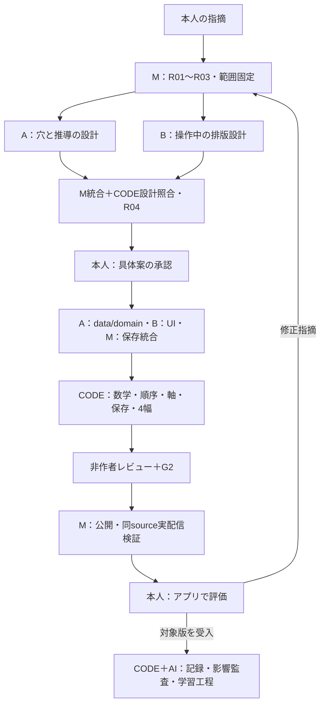

# N08修正・実装提案書 — W-MATH-041 / P-001

Status: PROPOSED（教材の改修・公開は未実施）
対象：数学教科書モード N08「絶対値」、第6版から第7版へ。
原版：`e7320590d4af51b7cc0d9faa918485467092a3c0`。現在地main：`5fee3d8a19e2ecfaa9e959d67a33587dd5c4c30b`。
親Work：W-MATH-040。未解決の本人指摘：`1fb0e4f5848eea9231f8`。
入口：既存CMD-WORK-001「修正」。今回はこの具体案の作成まで。

## 1. 決定してほしい変更

N08の説明・問題・39個の元ノード・12段階を保ち、次の二点を一緒に修正する。

1. 完成した式を選ぶ回答を、式を作る途中の部品へ移す。特にQ07/Q09の分配とQ12の二乗で、学習者の操作より先に完成した途中式を見せない。
2. 空欄・入力中・誤答・正答の数式基準線と共通列を揃える。押しやすさの44pxと数学上の位置を別に定義し、入力のたびに式が上下・左右へ動く構造を改める。

既に改善した文章の細かさ、原問・条件・前結果の記録、18pxの数式、等式を順にたどる形は引き継ぐ。本文全体の書き直しや別教材への適用を、この修正へ混ぜない。本人は第6版を未承認と明示している。今回の具体案の承認と、その後の公開教材の品質受入は別である。

## 2. 現版の不足と、前回の検査が通った理由

- 第6版：construction11親15部品＋従来回答22件＝必須33親、独立した回答決定37個。新UIの15部品だけを全穴数のように扱わない。
- 従来回答22件のうち7件は完成式・完成した式の組・理由文のパッケージ選択。これを全部同じ「数の穴」と呼ぶのは不正確。
- Q07/Q09は分配後の完成式が先に見え、符号等の穴がその写しになり得る。
- 新UIの外側gridはbaselineでも、cell内部はcenter。空buttonとKaTeX文字ではbaselineの供給条件が変わる。単に一つのCSSをbaselineへ変更するだけでは空欄の問題が残る。
- 実配信artifactのQ02では、390/1440pxで行幅144→83px、左端30.5px移動。値が揃っていても、正答後にレイアウトを作り直している。
- 前回の検査は字号・列・番号・はみ出し・操作領域が中心で、行内baselineと同じanchorの状態間移動を直接検査していない。数学内容ではなく100%幅の外枠を中央測定に使う箇所もあった。

今回の原画像はW040/USER_R6_FEEDBACK.jsonでhashを固定。元の画像や原発言を外部公開用の提案本文へ複製しない。観察は実配信artifactと読取に基づき、新しい改修版のbrowser合格を既に取得したとは扱わない。

## 3. 新版の穴の数え方

全39ノードは維持する。既出結果を再選択する3親（n08-01、n08-10、n08-12）を自動記録へ変更し、採点だけを外す。本文・数学的結論を削除する変更ではない。

新版は必須30親、回答決定42個を設計基準とする。内訳はconstruction20親32部品＋従来の局所回答10親10個。旧版の37決定から実質5決定増える。完成式の選択を途中の穴へ移す効果と、総数の増加を区別する。

前版と意味が同じ16親18決定は、照合した保存を継承する。意味を変える14親24部品には新しいIDを与え、旧正答を新しい部品の正答に変換しない。厳密な親/部品/移行表はNODE_DESIGN.jsonと後半の全39ノード表に記す。

## 4. 穴を置く基準

各部品は「何を判断するか」「既に何を知っているか」「どの結果を次へ渡すか」を一つずつ持つ。

- 問題で与えた数、初出の定義、図の凡例、元の条件は提示する。
- 座標の位置、適用する場合、演算の対象、符号付きの項、積や差の値を本人へ渡す。
- 同じ操作を両辺・二項へ使う箇所は、一度の回答を必要な位置へ反映する。表示上二か所でも独立二回答にはしない。
- 計算済みの値を単にまとめ直す穴は自動記録へする。
- 箱を増やすために、負の数の符号と値をすべて別採点にすることはしない。
- 選択肢は、今作っている部品に対応する数・符号・項・範囲。完成した最終式を選ばせて、部品入力に見せかけない。
- 原問に忠実な条件や既知の規則の提示と、現在の操作の答えを先に完成させることは分けて点検する。

## 5. 教材の表示順と三状態

各段階は「原問・使う条件・前結果→短い方針→式列→必要箇所の短い説明→結果の記録」の順。

初期状態では現在行と現在部品だけ操作できる。未習の後続行は、CSSで隠すのではなくprojectionから除外する。部分入力では答えた部品を同じ位置に残し、次の部品へ進む。正答後は同じ式列の行を残し、不要な操作説明だけを畳む。「説明を詳しく見る」で根拠を再読できる。

Q07/Q09/Q11/Q12には一つの親の中に複数の小段階がある。このため、親単位の解決だけでなく、`steps / requiresCorrectParts / visibleAfterParts`を追加する。前の部品が正しくない限り、その計算結果を後続行へ出さない。単に全部の部品が埋まるまで結果を隠す現在方式では不足する。

途中の誤選択にはその部品の根拠に戻す説明を出す。未完成の親を丸ごと一誤答に数えない。既存isFirstCorrectは初回の全回答draftの正誤という意味を保ち、全部品の最初の選択が正しかったかはfirstPassAllPartsCorrectとして別に導出する。親のattemptCountは全部の独立部品が一回揃った時点で増え、途中の選択履歴はpartRecordsへ残す。前段で誤り、その後直して最初の全回答が正しい場合も、途中のfirstValueは誤選択のまま保持する。node前提は現在版の親IDへ一貫して解決し、説明・手本・自動結果への依存はsource factの可用性と、その前提親も照合する。旧親の依存だけをコピーして新親の前提を空にしない。

## 6. 排版の固定仕様

### 6.1 中央に置く対象

中央へ置くのは、その問題の一続きの式列を収める「数学frame」である。左辺幅・等号列・右辺開始位置を、このframeで共有する。

毎状態で可視文字の中心を本文中央へ動かすこと、等号位置を動かさないこと、入力欄を正答後に自然な式へ圧縮することを同時に要求しない。主教材ではframe/等号列を固定する。正答後の短い右辺には末尾の余白を許す。前結果・履歴の静的な再掲では、別のcompact frameを作れる。

行のx座標を固定ピクセルで決め打ちするのではなく、フォント読み込み後に、全group・親内全stepの候補幅・既知の式の幅・44px領域からframeを測る。未来の正答行をhidden DOMに置いて測らない。中立な構文断片と全部の候補を同等に扱った部品metricsだけを使い、数値envelopeを先に固定する。現在の値が変わっただけでは列幅を更新しない。viewport・フォント・zoomが変わったときだけ再測定する。

### 6.2 数学上の位置と操作領域

通常式は18px、KaTeXは1em。空欄にも、同じKaTeXのstrutを持つ透明な数学要素を置き、空のbuttonの底や箱の幾何中心にbaselineを依存させない。

44pxの押下領域と、見える小枠/値を別レイヤーとして持つ。新constructionだけでなく、維持する局所回答の数式欄・両辺mirror欄も同じaxis adapterへ通す。日本語の符号語は通常本文の操作欄とし、TeXのtextへ押し込まない。前者で数学のbaselineを合成しない。隣の穴に重なる疑似要素で領域を水増しせず、実ボタンのhitboxを測定する。

通常の記号・負号・根号・括弧・指数は字形の上端やbbox中心を揃えない。分数では分数線に対する数学軸、通常式では共通baselineを測る。空・選択済・誤答・正答で同じ基準要素を使う。

### 6.3 数字、行間、狭い画面

- 数式18px、本文の既存サイズ、行間4px、必須注記6px、本文との間8pxを維持。
- 一つの行の全体に等号を一つ置く。係数や符号の選択肢を縦に並べたことを、等式変形の改行に使わない。
- 番号(1)〜(32)の参照先は維持。増やした中間行は同じ論理式の内部行とし、独立番号を乱増させない。
- 番号は「現在見える最後の数学行の安定した基準線」へ置く。最後のKaTeX片が負号か分数かで上下させない。
- 番号と式の間は8px以上。衝突時だけ番号を直下の右へ移し、式本体の中央frameをずらさない。
- 320pxでは長い導入左辺を上の一行へ逃がし、続く右辺列と等号列を共有する。演算子とその項、括弧内のまとまりの途中で任意に折り返さない。
- 選択肢は式列の外側で一候補一行。選択肢の幅を数式列の幅へ混ぜない。

### 6.4 activeとkeyboard focus

通常borderに加えて、状態表示は一つのringだけにする。activeのringとfocus-visibleの外枠を重ねない。keyboard操作の位置は常に分かるようにする。pointerとkeyboard、誤答の組合せを検査する。

## 7. 教材データ・CODEの追加仕様

既存のconstruction-layout/1を入口にし、明示opt-inの`axis-contract/1`と`part-sequence/1`を追加する。既存r6等に必須の新fieldを黙って課さない。

| 契約 | 追加する情報 | CODEで拒否するもの |
|---|---|---|
| 部品の意味 | role、expected、choices、sourceRefs、前提、nextUse、meaningHash | 未定義role/値、参照切れ、完成式にしか対応しない不透明な部品 |
| 親内の順序 | stepId、parts、requiresCorrectParts、visibleAfterParts、rowRefs | 循環、後段を前提にした行、同じ決定の独立二重採点、前段未正答での後続projection |
| 場合の条件 | a≥0/a<0等のassumptionRefとsource | 条件なしの不等式検証、特定値だけで一般式を承認 |
| 自動結果 | derivedFromInteractionIds、resultId、graded=false | 前提未解決での結論、架空の正答履歴、総問題数への加算 |
| 軸とframe | mathStyle、strutProfile、framePolicy、partEnvelope、numberBaselineRef、responsiveBreak | sourceのないoffset、取得できないbaselineをPASSへ代用、状態だけで列幅変更 |
| 保存移行 | from/to revision、旧ID、新ID、meaningHash、copy/archive/reopen理由 | 新しい意味への正答の自動移植、resetした空記録の再充填 |

数式選択の正誤と、指定順への整形は区別する。例えば−√5+3は数学的には正しく、正の項を先へ置く指定だけ未達と伝える。数式の等値性を誤り扱いしない。親内の行ごとの等値性も検査し、最後の式だけ合っていても途中の誤操作を合格にしない。

finite候補の組合せは既存math adapterへ渡す。行の真偽だけでなく、前行からの操作と結果の一致を検証する。維持する両辺操作の穴でも、正しい別の不等式を作れたことと、指定された中身を左辺に作れたことを区別する。例えば3−π<πや3−π<3も真だが、π−πを計算した右辺ではない。Q08ではπ−π=選択値の遷移根拠も検査し、operation-resultの不一致として説明する。予算を超えたもの、条件や構文に対応できないものはUNSUPPORTEDとし、人の同意でPASSへ変えない。数学的に正しい誤答候補がないかも検査する。

### 7.1 旧契約を壊さないversion分岐

新しいデータの正本はconstruction-plan/2、construction-interaction/2、layout-plan/2、transformation-plan/3、transformation-reading/3、construction-visible/2とする。入口のproduction/2・team/1・construction-layout/1は変えない。既存の4つの設計/コピー/compiled hashの中へstepとaxis契約を含め、別の非照合JSONとして付け足さない。

unitでは意味同一の6親を既存constructionItemsに残し、新意味14親をconstructionItemsV2へ置く。従来10回答はsection.itemsのまま。resolverと合計は両方のconstructionと局所回答を合わせる。同じ意味の6親を新schemaのためだけに別の問題として再作成しない。r7readerは三種類を共通の表示adapterへ正規化する。

Node側のconstruction-v2、transformation-v3と、Browser側の同じversion判定/statement grammarを追加する。v1/v2の既存transform出力はbyte/hash一致を維持する。新statementのrelation、意味語、source subtree参照は型で分け、×はmultiply ASTへ明示dispatchする。一般文字列のevalや、旧binaryの+/-分岐へ×を流す実装は禁止。

親内stepを進んだ後の正答部品は読み取り専用。誤答中の部品は編集可能。保存破損や将来のAPI操作で前提部品が誤答に戻った状態でも、後続の行・注記・panel・結果参照をすべて再閉鎖する。前提が見かけ上変わっても古いresolvedフラグを信用しない。

## 8. 実装するファイルと役割

旧r6を比較可能に保つため、既存r6 leaf/renderer/CSSを改変の正本として使わず、新しいr7側を追加する。共通domainはoptionalな契約を追加し、旧入力の出力一致を検証する。

| 対象 | 実装内容 | 担当 |
|---|---|---|
| src/data/textbook/math/numbers/n08Revision7.json | 原39ノード/12段階、30親、source対応、本文差分、自動結果 | A |
| n08ConstructionR7.json / n08LayoutR7.json / n08ConstructionPresentationR7.json | 全部品・小段階・式列・注記・軸/番号契約を生成 | A、排版契約はB |
| src/domain/constructionReading.ts、constructionProgress.ts、textbookSchema.ts | step型、scope等の限定拡張、projection、部分入力の型と検算 | A |
| src/domain/textbook.ts / src/stores/useAppStore.ts | r6→7の意味照合移行、archive、正答/合計、reset、event重複排除 | A、M統合 |
| src/components/textbook/ConstructionMathRow.tsx、MathAxisSlot.tsx、construction-math-axis.css | r7専用baseline/frame/slot/44px、candidate envelope | B |
| N08ConstructionReadingFlowV7.tsx | 固定式列、部品順序、前結果・履歴・部分/誤答表示、scalarへの橋渡し | B |
| src/pages/N08Revision6Page.tsx | r6比較をsession内で操作。現r7保存へ書かない | M |
| TextbookUnitPage.tsx、n08Lesson.ts、n08ActiveVersion.json | r7分岐・version=6・既存4/5/originalの保持 | M |
| ConstructionMathRow.tsx内のr7専用番号wrapper | 明示baseline anchorを持つ。旧NumberedEquation.tsxは変更しない | B、M審査 |
| tools/textbook/interaction/construction.mjs / construction-v2.mjs | v2明示dispatch、step依存・候補・行/遷移の検算。v1の出力を保持 | A |
| tools/textbook/layout/plan.mjs、measurements.mjs、axis-measurements.mjs | opt-in軸/frameの実測契約。旧48測定を新合格に使わない | B、M統合 |
| tools/textbook/transformation/schema.mjs・validate.mjs・compile.mjs・visible.mjs・plan.mjs / v3.mjs | 新plan/reading/visibleの明示dispatch、原source対応、親内行binding、4hashを検査 | A、M統合 |
| tools/textbook/ai/solution-review.mjs、workflow/capabilities.py | 実projectionに対する先出し/教える順/意味審査、既存capabilityへの接続 | M |
| tools/textbook/corpus/construction_context.py | 新versionの部品/step/axis指標をsource付きで抽出。旧modelのfeature schema不一致は予測へ流さない | M |
| tools/textbook/transformation/apply-n08-r7.mjs | 承認済みNODE_DESIGNと元sourceからr7を生成。同じ入力で同じhash | A |
| Work041のverify_app.mjs、release_manifest.mjs、domain/UI/workflow各test | 同sourceの全操作と軸の測定、protected照合、manifest | M、非作者が反証 |
| .github/workflows/n08-r7-ci.yml / deploy-pages.yml | 正確なapp sourceのCIと既存Pages公開、公開後照合 | M |

予定ファイル名はこの表で固定する。対象外の全体refactor、依存lock更新、他単元の排版変更は本提案へ含めない。既存共通ファイルを変更する箇所は、opt-in分岐とその検査に限定する。

## 9. 第4・5・6版と学習記録

- r7を現在版にして、version=6、version=5、version=5&layout=original、version=4を残す。layout=originalは従来どおりr5 originalへのalias。
- r6の問題・construction・layout・presentation・reader・CSSは保護manifestへ登録。比較画面はephemeralで、現在版の保存を更新しない。
- namespaceはkyotsu-step-gate3-math-20261023を維持。履歴はarchivedRevisionsへ全体保存。
- 意味同一の16親18決定はsemantic fingerprint一致時のみ正答・未完draft・firstValue・時刻を継承。位置や字体だけの修正で再解答を強制しない。
- 意味変更14親24部品は新IDと空状態で開く。古い全式の正答から各符号の正答を推定しない。
- 廃止3親はarchiveに残し、r7では自動結果へ。成功した架空の解答イベントを生成しない。
- 既存の空r7 recordは、reset後も正式な状態として優先する。旧r6を見て戻ったときに昔の正答を復活させない。
- r4/r5から直接来た保存にも、既存移行を順に使ってr6へ正規化してからr7へ。過去のcompletedAtを現在の完了と取り違えない。

## 10. 検査と出荷条件

| 検査 | 実行内容 | 不合格の扱い |
|---|---|---|
| source/設計 | 全39ノード、30親、42決定、原条件・原結果・図・注記の対応、hash固定 | 欠落や不一致で止める |
| 数学 | 全候補の有限組立、条件付き比較、scope/符号/積/二乗、指定順の区別 | FAIL/UNSUPPORTEDを多数決で通さない |
| projection | 初期/partial/wrong/complete、親内全step、後続行と説明の先出し | DOMにhiddenで残す方式も不合格 |
| 軸 | 通常式のbaselineと分数等の対応axisを実DOM markerから計測、許容差1 CSS px | 取得不能はUNVERIFIED、出荷不可 |
| 状態間位置 | 同viewport・同fontのframe左端/左辺開始/等号/右辺開始列の最大差1px。slot centerは同じ部品が編集可能な状態の間だけ比較し、resolvedで自然式へ圧縮後の字形位置と混同しない | 再中央寄せや幅再計算による移動を拒否 |
| frame中央 | 数式frameの実boundsと本文content centerを比較、許容差2px。可視文字unionも別途記録 | 100%幅の外枠の中心だけでPASSにしない |
| 操作領域 | 全部品44×44px以上、隣接領域非重複、keyboard focus一つ、panelと番号の衝突なし | 一部部品だけの確認を全件へ一般化しない |
| 4幅 | 320/390/430/1440px、空/active-pointer/active-keyboard/filled/wrong/resolved、全候補を操作 | fontsize/font環境差を混ぜず別記録 |
| 保存 | 同意味継承、新意味再開、未完draft、旧版比較、reset、復帰、二重event、旧4/5/6履歴 | 正答捏造・履歴消失・復活を拒否 |
| 完了導線 | 最終正答→既存の完了表示/導線→既存次教材link→期待unit IDを実操作 | static完了文だけの表示待ちを導線成功と呼ばない |
| 回帰 | 旧N08r4/r5/r6、N09/N10表示、N11全問、共通domainとworkflow、lint/build | 保護対象の変更を本修正へ混ぜない |
| 実物レビュー | 対象sourceの実PNGと操作結果を非作者が確認 | CODE PASSだけで教育・見た目を受入にしない |
| 公開後 | release.json source/revision/契約hash/namespace、同SHAの4幅操作 | CI版と公開版が違えば確認用に渡さない |

最後まで解いて「反応がない」との報告は、会話側かアプリ側か未確定である。今回は完了導線の実操作検証を追加する。新しい完了画面や自動遷移を、推測で本案へ足さない。実装中に別原因の不具合が確認された場合は、証拠と限定修正案を示す。

## 11. CODE・AI・本人を既存修正フローへ入れる

R01/R02/R03で、原画像・指摘・source・依存・保護対象を固定する。Aが教える順序と穴の意味、Bが式と操作中の幾何、Mが保存・route・全体を調べる。CODEは対応表・差分・有限候補・幾何を扱う。

R04で本案と全39ノード/部品/文/表示契約を確定する。AとBの案は互いの担当外をレビューし、Mの統合も審査対象にする。本人はこの具体案を判断する。登録・担当・作者履歴は実作業前に束縛し、後から登録したものを事前レビューと呼ばない。

R05/R06で承認済みの式・部品・コピー・表示hashから制作する。R07でCODE検査と非作者の教え方/実物レビューを実行し、G2で保護対象と統合を監査する。G3_HOSTで既存公開appへコンパイルし、同sourceを実配信で確かめる。本人はG3_FINALでappを操作して判断する。別の画像票承認・公開許可の再質問は加えない。

作成CMD-WORK-002でも共通のpart-sequence/axis契約を既存設計・制作・検証工程内から使用できる。ただし今回適用する教材はN08のみで、別の作成入口や自動全単元変換を作る変更ではない。

CODEは教育的に適切な穴かを数だけで判定しない。AIも幾何実測・全候補・保存互換のFAILを説明で打ち消さない。A/Bが同じモデル・共有履歴であることは明記し、別threadをモデル独立の監査と呼ばない。

## 12. 機械学習へ何を渡すか

今回の指摘は、r6/source/画像/対象箇所付きの「式中の軸不一致」「状態切替での位置移動」「必要な操作を先に完成して見せる」「完成式選択の残存」に分ける。本人が指摘したものとAIが追加で発見したものは別のsource区分を持つ。

改善したという本人の発言は部分的な好評として残すが、N08全体や排版の肯定ラベルへ変換しない。旧版の受入も新しいr7ラベルにしない。

まず確定した事例を回帰fixtureとcase catalogへ結び付ける。CODEの特徴量には、完成式回答の割合、未解決stepに依存する表示数、baseline未検証数、状態間anchor移動、操作領域の重複、計算根拠と行の真偽の区別を持たせる。これらを本人の主観評価ラベルそのものにはしない。feature schemaが旧modelと異なる場合は推論を止め、既存の不明値を0として補完しない。MLは既存L01工程で、ラベル/クラス/独立した問題family/holdoutが成立するheadだけ再学習・評価する。成立しなければNOT_TRAINABLEを記録し既存モデルを保持する。作った誤答選択肢を、人が拒否した教材事例の水増しに使わない。新モデルが採用されても助言用であり、数学/CODE/実物審査や本人受入の代わりにはしない。

今回の具体案作成段階ではfitなし。既存modelのOFFLINE_ONLYを維持する。

## 13. 公開と戻し方

実装は固定source e7320590から独立branchへ。mainの古い実装ファイルを丸ごとmergeして上書きしない。mainは提案・承認・現在地の記録と、sourceを固定するpublisherとして扱う。

承認後は旧版を保持したままr7をbuildし、公開後の同source検証が終わったら、いつものN08 app URLを渡す。URLのvには実際のコードSHAを入れる。版番号だけ書き換えたURLを新版と呼ばない。

不満がある場合はversion=6で比較できる。正式に既定版を戻す際も、r7の保存をarchiveし、既存namespaceを破壊せず戻す。旧sourceを失わないよう、appsource/publisherSHA/manifest/検証runを別々に記録する。

## 14. 今回の承認範囲

承認対象は、本文にある全39ノードの扱い、42決定の部品契約、親内step、排版仕様、保存移行、限定CODE拡張、検査・公開・旧版保持の一式。

承認後に制作と既存appへの公開まで進み、同じ公開許可を繰り返し求めない。公開版の品質受入は実物を見た本人が判断する。未承認の現r6を合格・学習Gold・完了Workにしない。

この提案に未確定の「検討」項目を残さず、後半のnode/part表とIMPLEMENTATION_CONTRACT.jsonを照合してから提示する。以下の全39ノード表はその具体設計である。

## 15. 全39ノードの確定設計
正答・選択肢は制作者用。学習者画面へ正答欄ごと表示しない。□は現在の部品。同じ係数の再掲は一つの回答を反映したもので、追加の穴ではない。

### 01. n08-q01-right — 右側の点から原点までの距離
**方針：説明・手本を維持**
本文：図の右側にある 2.3 の点を見ます。原点の座標は 0 です。右側の座標から左側の座標を引き、距離を求めます。
前提：この問題の与条件。新しい数学上の前提なし。。
保存・採点：新しい解答イベントを作らない。
確定後：元の説明・定義・手本・境界・まとめを保持する。原参照はNODE_DESIGN.json/sourceSemanticRefsに固定。
この結果は次の元ノード/段階へ受け渡し、参照はnodeId/resultIdで保持する。

### 02. n08-q01-left — 左側でも右の座標から左の座標を引く
**方針：既存の局所回答を維持**
本文：-5 の点は原点の左側です。右側は 0、左側は -5 なので、距離は 0-(-5) と表せます。
前提：n08-q01-right。
表示する式：
$$
0-(-5)=\square
$$
| 入力順 | 部品ID・役割 | 選択肢（表示順） | 正答 |
|---|---|---|---|
| 1 | n08-q01-left-answer::answer / local-formula | 5 / -5 / 0 | 5 |
部品 answer：左側でも右の座標から左の座標を引く 誤答時：前の式と、今の操作の目的を照らし合わせます。
保存：意味同一の旧ID/値/履歴を保持。
確定後の結論：
$$
5
$$
この結果は次の元ノード/段階へ受け渡し、参照はnodeId/resultIdで保持する。

### 03. n08-01 — 元の順序で二つの距離をまとめる
**方針：結論を自動記録（採点なし）**
本文：二つの距離を、元の問題の順序で記録します。
前提：n08-q01-right、n08-q01-left。
保存・採点：新しい解答イベントを作らない。
確定後の結論：
$$
2.3,\quad5
$$
表示条件：上記すべての前提結果が確定した後。前結果欄と履歴にも同じ結論を記録し、分母30へ加えない。
この結果は次の元ノード/段階へ受け渡し、参照はnodeId/resultIdで保持する。

### 04. n08-definition — この距離を絶対値と名付ける
**方針：説明・手本を維持**
本文：実数 a を表す点と原点との距離を、絶対値といい、|a| と書きます。縦の二本の線は、中にある式全体について距離を取る記号です。
前提：n08-01。
保存・採点：新しい解答イベントを作らない。
確定後：元の説明・定義・手本・境界・まとめを保持する。原参照はNODE_DESIGN.json/sourceSemanticRefsに固定。
この結果は次の元ノード/段階へ受け渡し、参照はnodeId/resultIdで保持する。

### 05. n08-r5-q02-distance — 右側の点と原点の距離の式を作る
**方針：穴の意味を維持し排版を修正**
本文：条件a≥0を使い、点aと原点の位置を確認します。距離は、右の座標から左の座標を引いて表します。
前提：n08-definition。
表示する式：
$$
|a|=\square-\square
$$
| 入力順 | 部品ID・役割 | 選択肢（表示順） | 正答 |
|---|---|---|---|
| 1 | n08-r5-q02-distance-build-r6-right / coordinate | a / 0 | a |
| 2 | n08-r5-q02-distance-build-r6-left / coordinate | a / 0 | 0 |
部品 n08-r5-q02-distance-build-r6-right：右側の点と原点の距離の式を作る。 誤答時：点の位置を条件と照らし、右側の座標から左側の座標を引く順序を確かめます。
部品 n08-r5-q02-distance-build-r6-left：右側の点と原点の距離の式を作る。 誤答時：点の位置を条件と照らし、右側の座標から左側の座標を引く順序を確かめます。
保存：意味同一の旧ID/値/履歴を保持。
確定後の結論：
$$
|a|=a-0
$$
この結果は次の元ノード/段階へ受け渡し、参照はnodeId/resultIdで保持する。

### 06. n08-02 — 原点か右側なら座標が距離になる
**方針：式中の判断を改訂・新ID**
本文：前のa−0を計算し、絶対値を外した式を完成させます。
前提：n08-r5-q02-distance。
小段階 simplify（前提部品：なし）
$$
a-0=\boxed{\phantom{0}}
$$
| 入力順 | 部品ID・役割 | 選択肢（表示順） | 正答 |
|---|---|---|---|
| 1 | n08-02-build-r7::term / operand | a / -a / 0 | a |
部品 term：引き算を整理すると、距離はどの項になりますか。 誤答時：直前の式で扱っている数や項を、符号を含めて確かめます。
保存：新ID n08-02-build-r7。旧正答/途中draftはarchiveのみ。
確定後の結論：
$$
|a|=a\quad(a\ge0)
$$
この結果は次の元ノード/段階へ受け渡し、参照はnodeId/resultIdで保持する。

### 07. n08-q03-order — 左側の点の距離を引き算で作る
**方針：穴の意味を維持し排版を修正**
本文：a<0の条件を使い、点aと原点の左右関係を確かめます。正のときと同じ距離の求め方を使います。
前提：n08-02。
表示する式：
$$
|a|=\square-\square
$$
| 入力順 | 部品ID・役割 | 選択肢（表示順） | 正答 |
|---|---|---|---|
| 1 | n08-q03-order-build-r6-right / coordinate | 0 / a | 0 |
| 2 | n08-q03-order-build-r6-left / coordinate | 0 / a | a |
部品 n08-q03-order-build-r6-right：左側の点の距離を引き算で作る。 誤答時：点の位置を条件と照らし、右側の座標から左側の座標を引く順序を確かめます。
部品 n08-q03-order-build-r6-left：左側の点の距離を引き算で作る。 誤答時：点の位置を条件と照らし、右側の座標から左側の座標を引く順序を確かめます。
保存：意味同一の旧ID/値/履歴を保持。
確定後の結論：
$$
|a|=0-a
$$
この結果は次の元ノード/段階へ受け渡し、参照はnodeId/resultIdで保持する。

### 08. n08-03 — 左側の距離を簡単にする
**方針：穴の意味を維持し排版を修正**
本文：0からaを引く計算を、aの一つの項で表します。
前提：n08-q03-order。
表示する式：
$$
0-a=\square a
$$
| 入力順 | 部品ID・役割 | 選択肢（表示順） | 正答 |
|---|---|---|---|
| 1 | n08-03-build-r6-sign / unary-sign | - / + | - |
部品 n08-03-build-r6-sign：左側の距離を簡単にする。 誤答時：中身や因数の符号を一つずつ確認し、今適用している規則を確かめます。
保存：意味同一の旧ID/値/履歴を保持。
確定後の結論：
$$
|a|=-a\quad(a<0)
$$
この結果は次の元ノード/段階へ受け渡し、参照はnodeId/resultIdで保持する。

### 09. n08-q04-substitute — 負の値は括弧を付けて代入する
**方針：説明・手本を維持**
本文：いまの式 -a の a へ -5 を入れます。元からある負号と代入する負の数を区別するため、代入する数を括弧で囲みます。
前提：n08-03。
保存・採点：新しい解答イベントを作らない。
確定後：元の説明・定義・手本・境界・まとめを保持する。原参照はNODE_DESIGN.json/sourceSemanticRefsに固定。
この結果は次の元ノード/段階へ受け渡し、参照はnodeId/resultIdで保持する。

### 10. n08-04 — 代入した式の値を計算する
**方針：穴の意味を維持し排版を修正**
本文：負の数 -5 と符号が反対の数を求めます。式と値を等号でつないで、左側の点の距離と照合します。
前提：n08-q04-substitute。
表示する式：
$$
-(-5)=\square
$$
| 入力順 | 部品ID・役割 | 選択肢（表示順） | 正答 |
|---|---|---|---|
| 1 | n08-04-build-r6-value / rational | 5 / -5 / 0 | 5 |
部品 n08-04-build-r6-value：代入した式の値を計算する。 誤答時：直前の演算を、その二つの数の符号も含めて計算し直します。
保存：意味同一の旧ID/値/履歴を保持。
確定後の結論：
$$
-(-5)=5
$$
この結果は次の元ノード/段階へ受け渡し、参照はnodeId/resultIdで保持する。

### 11. n08-cases — 絶対値を外す規則を二つにまとめる
**方針：説明・手本を維持**
本文：ここまでの二つの場合を、条件と式が対応する表にまとめます。
前提：n08-02、n08-03。
保存・採点：新しい解答イベントを作らない。
確定後：元の説明・定義・手本・境界・まとめを保持する。原参照はNODE_DESIGN.json/sourceSemanticRefsに固定。
この結果は次の元ノード/段階へ受け渡し、参照はnodeId/resultIdで保持する。

### 12. n08-q05-square — 正の二数の大小を比べる準備
**方針：既存の局所回答を維持**
本文：求めたいのは |\sqrt5-3| を絶対値記号のない式で表すことです。まず中身の符号を決めるため、\sqrt5 と 3 を比べます。\sqrt5 は正で、二乗すると 5 になる数です。二つの数はともに正なので、二乗した値を比べて元の数の大小を決められます。はじめに \sqrt5 の二乗を確かめ、次に 3 の二乗を計算します。
前提：n08-cases。
表示する式：
$$
3^2=\square
$$
| 入力順 | 部品ID・役割 | 選択肢（表示順） | 正答 |
|---|---|---|---|
| 1 | n08-q05-square-answer::answer / local-formula | 9 / 6 / 3 | 9 |
部品 answer：正の二数の大小を比べる準備 誤答時：前の式と、今の操作の目的を照らし合わせます。
保存：意味同一の旧ID/値/履歴を保持。
確定後の結論：
$$
9
$$
この結果は次の元ノード/段階へ受け渡し、参照はnodeId/resultIdで保持する。

### 13. n08-q05-compare — 二乗した値の大小を決める
**方針：既存の局所回答を維持**
本文：両方とも正なので、二乗した値の比較を元の二数の比較に戻せます。まず 5 と 9 の間の不等号を選びます。5\ \ 9
前提：n08-q05-square。
表示する式：
$$
5\;\square\;9
$$
| 入力順 | 部品ID・役割 | 選択肢（表示順） | 正答 |
|---|---|---|---|
| 1 | n08-q05-compare-answer::answer / local-text | < / > / = | < |
部品 answer：二乗した値の大小を決める 誤答時：前の式と、今の操作の目的を照らし合わせます。
保存：意味同一の旧ID/値/履歴を保持。
確定後の結論：
$$
<
$$
この結果は次の元ノード/段階へ受け渡し、参照はnodeId/resultIdで保持する。

### 14. n08-05 — 根拠と元の数の大小関係を結ぶ
**方針：式中の判断を改訂・新ID**
本文：二つとも非負です。二乗した値の比較を、元の二つの数の比較へ戻します。
前提：n08-q05-square、n08-q05-compare。
小段階 given-comparison（前提部品：なし）
$$
5<9
$$
小段階 root-comparison（前提部品：なし）
$$
\sqrt5 \boxed{\phantom{0}} 3
$$
| 入力順 | 部品ID・役割 | 選択肢（表示順） | 正答 |
|---|---|---|---|
| 1 | n08-05-build-r7::relation / relation | > / = / < | < |
部品 relation：二乗した値の比較から、元の二数の大小を決めます。 誤答時：前の比較や場合分けの結果を、今の二つの数の関係へつなげます。
保存：新ID n08-05-build-r7。旧正答/途中draftはarchiveのみ。
確定後の結論：
$$
\sqrt5<3
$$
この結果は次の元ノード/段階へ受け渡し、参照はnodeId/resultIdで保持する。

### 15. n08-r5-q06-operation — 前の大小関係から中身の符号へつなぐ
**方針：既存の局所回答を維持**
本文：元の絶対値の中身は \sqrt5-3 です。先ほど得た \sqrt5<3 を、この中身と比べられる形に変えます。両辺から同じ数を引く式を作ります。
前提：n08-05。
表示する式：
$$
\sqrt5-\square<3-\square
$$
| 入力順 | 部品ID・役割 | 選択肢（表示順） | 正答 |
|---|---|---|---|
| 1 | n08-r5-q06-operation-answer::answer / local-formula | 3 / -3 / 0 | 3 |
部品 answer：前の大小関係から中身の符号へつなぐ 誤答時：同じ数を両辺から引く操作自体は使えます。今回は左辺に√5−3を作るため、引く数を選び直します。
保存：意味同一の旧ID/値/履歴を保持。
確定後の結論：
$$
3
$$
この結果は次の元ノード/段階へ受け渡し、参照はnodeId/resultIdで保持する。

### 16. n08-q06-subtract — 両辺から同じ数を引いて差の符号へ
**方針：既存の局所回答を維持**
本文：右辺に同じ数の差が残りました。左辺は元の絶対値の中身です。右辺を計算し、中身の符号を読み取れる形に整理します。
前提：n08-r5-q06-operation。
表示する式：
$$
\sqrt5-3<\square
$$
| 入力順 | 部品ID・役割 | 選択肢（表示順） | 正答 |
|---|---|---|---|
| 1 | n08-q06-subtract-answer::answer / local-formula | 0 / 3 / -3 | 0 |
部品 answer：両辺から同じ数を引いて差の符号へ 誤答時：前の式と、今の操作の目的を照らし合わせます。
保存：意味同一の旧ID/値/履歴を保持。
確定後の結論：
$$
0
$$
この結果は次の元ノード/段階へ受け渡し、参照はnodeId/resultIdで保持する。

### 17. n08-06 — 差が0より小さいことを言葉で読む
**方針：既存の局所回答を維持**
本文：絶対値の中身を0と比較できました。この結果を、正・0・負という言葉で読み取ります。判断：
前提：n08-q06-subtract。
表示する式：
$$
\sqrt5-3
$$
| 入力順 | 部品ID・役割 | 選択肢（表示順） | 正答 |
|---|---|---|---|
| 1 | n08-06::answer / local-text | 負 / 正 / 0 / 符号は決まらない | 負 |
部品 answer：差が0より小さいことを言葉で読む 誤答時：前の式と、今の操作の目的を照らし合わせます。
保存：意味同一の旧ID/値/履歴を保持。
確定後の結論：本文で「負」と記録し、根拠の不等式を併記する。
この結果は次の元ノード/段階へ受け渡し、参照はnodeId/resultIdで保持する。

### 18. n08-q07-rule — 負の場合に使う規則を選ぶ
**方針：式中の判断を改訂・新ID**
本文：uは絶対値の中身を表します。中身が負の場合に使う規則を、式の中で完成させます。
前提：n08-06、n08-cases。
小段階 rule（前提部品：なし）
$$
|u|=\boxed{\phantom{0}}u\quad(u<0)
$$
| 入力順 | 部品ID・役割 | 選択肢（表示順） | 正答 |
|---|---|---|---|
| 1 | n08-q07-rule-build-r7::rule-sign / unary-sign | - / + | - |
部品 rule-sign：中身が負の場合の規則を、表の条件と対応させます。 誤答時：中身や因数の符号を一つずつ確認し、今適用している規則を確かめます。
保存：新ID n08-q07-rule-build-r7。旧正答/途中draftはarchiveのみ。
確定後の結論：
$$
|u|=-u\quad(u<0)
$$
この結果は次の元ノード/段階へ受け渡し、参照はnodeId/resultIdで保持する。

### 19. n08-q07-bracket — 中身全体を括弧で囲んで負号を付ける
**方針：式中の判断を改訂・新ID**
本文：規則のuに、今回の式のどの範囲が対応するかを元の式で指定します。
前提：n08-q07-rule。
小段階 scope（前提部品：なし）
$$
|\sqrt5-3|=-(\boxed{\phantom{0}})
$$
| 入力順 | 部品ID・役割 | 選択肢（表示順） | 正答 |
|---|---|---|---|
| 1 | n08-q07-bracket-build-r7::whole-interior / bound-subtree-reference | 中身全体 / 第一項 / 第二項 | n08-q07-root-interior |
部品 whole-interior：規則のuが、この元の式のどの範囲に当たるか選びます。 誤答時：絶対値の縦線で囲まれた範囲と、規則のuの対応を確かめます。
保存：新ID n08-q07-bracket-build-r7。旧正答/途中draftはarchiveのみ。
確定後の結論：
$$
|\sqrt5-3|=-(\sqrt5-3)
$$
この結果は次の元ノード/段階へ受け渡し、参照はnodeId/resultIdで保持する。

### 20. n08-q07-distribute — 負号を括弧の二項へ掛ける
**方針：式中の判断を改訂・新ID**
本文：まず、括弧の前の負号を数を掛ける操作で表します。次に分配法則で各項へ掛け、最後に二つの積を計算します。
前提：n08-q07-bracket。
小段階 factor（前提部品：なし）
$$
-(\sqrt5-3)=\boxed{\phantom{0}}(\sqrt5-3)
$$
小段階 distribute（前提部品：coefficient）
$$
=(-1)\sqrt5+(-1)(\boxed{\phantom{0}})
$$
小段階 products（前提部品：coefficient, second-term）
$$
=\boxed{\phantom{0}}\sqrt5+\boxed{\phantom{0}}
$$
| 入力順 | 部品ID・役割 | 選択肢（表示順） | 正答 |
|---|---|---|---|
| 1 | n08-q07-distribute-build-r7::coefficient / coefficient | 1 / 0 / -1 | -1 |
| 2 | n08-q07-distribute-build-r7::second-term / operand | 3 / -3 | -3 |
| 3 | n08-q07-distribute-build-r7::root-sign / unary-sign | - / + | - |
| 4 | n08-q07-distribute-build-r7::constant / rational | -3 / 0 / 3 | 3 |
部品 coefficient：前行の外側の負号を、掛ける数で表します。 誤答時：外側の符号が中身の値をどのように変えるかを確かめます。
部品 second-term：元の括弧の第二項を、符号を含めた項として表します。 誤答時：直前の式で扱っている数や項を、符号を含めて確かめます。
部品 root-sign：第一項の積の符号を計算します。 誤答時：中身や因数の符号を一つずつ確認し、今適用している規則を確かめます。
部品 constant：第二項の積を計算します。 誤答時：直前の演算を、その二つの数の符号も含めて計算し直します。
保存：新ID n08-q07-distribute-build-r7。旧正答/途中draftはarchiveのみ。
確定後の結論：
$$
-\sqrt5+3
$$
この結果は次の元ノード/段階へ受け渡し、参照はnodeId/resultIdで保持する。

### 21. n08-07 — 正の項を先に並べて元の問いへ答える
**方針：穴の意味を維持し排版を修正**
本文：-\sqrt5+3 は、加法の交換法則で項の順を変えられます。絶対値も括弧もない形を、元の問題の答えにします。
前提：n08-q07-distribute。
表示する式：
$$
|\sqrt5-3|=\square+\cdots
$$
| 入力順 | 部品ID・役割 | 選択肢（表示順） | 正答 |
|---|---|---|---|
| 1 | n08-07-build-r6-first-term / signed-term | 3 / -\sqrt5 | 3 |
部品 n08-07-build-r6-first-term：正の項を先に並べて元の問いへ答える。 誤答時：前の二つの項を、符号ごと移します。値の等しさと指定された順序は別に確認します。
保存：意味同一の旧ID/値/履歴を保持。
確定後の結論：
$$
|\sqrt5-3|=3-\sqrt5
$$
この結果は次の元ノード/段階へ受け渡し、参照はnodeId/resultIdで保持する。

### 22. n08-q08-order — 円周率と3を比べる
**方針：既存の局所回答を維持**
本文：次は |3-\pi| を絶対値記号のない式で表します。与えられた \pi=3.14159\ldots を使い、まず中身の符号を決めるために 3 と \pi を比べます。3\ \ \pi
前提：この問題の与条件。新しい数学上の前提なし。。
表示する式：
$$
3\;\square\;\pi
$$
| 入力順 | 部品ID・役割 | 選択肢（表示順） | 正答 |
|---|---|---|---|
| 1 | n08-q08-order-answer::answer / local-text | < / > / = | < |
部品 answer：円周率と3を比べる 誤答時：前の式と、今の操作の目的を照らし合わせます。
保存：意味同一の旧ID/値/履歴を保持。
確定後の結論：
$$
<
$$
この結果は次の元ノード/段階へ受け渡し、参照はnodeId/resultIdで保持する。

### 23. n08-r5-q08-operation — 別の例で同じ両辺操作を組み立てる
**方針：既存の局所回答を維持**
本文：今回調べたい中身は 3-\pi です。3<\pi の両辺へ同じ操作を行い、左辺にこの中身が現れる式を作ります。
前提：n08-q08-order。
表示する式：
$$
3-\square<\pi-\square
$$
| 入力順 | 部品ID・役割 | 選択肢（表示順） | 正答 |
|---|---|---|---|
| 1 | n08-r5-q08-operation-answer::answer / local-formula | \pi / 3 / -\pi | \pi |
部品 answer：別の例で同じ両辺操作を組み立てる 誤答時：今回は左辺に3−πを作る操作です。不等式が成り立つことだけでなく、左辺が目的の式になっているか確かめます。
保存：意味同一の旧ID/値/履歴を保持。
確定後の結論：
$$
\pi
$$
この結果は次の元ノード/段階へ受け渡し、参照はnodeId/resultIdで保持する。

### 24. n08-q08-difference — 同じ数を引いて0との比較へ
**方針：式中の判断を改訂・新ID**
本文：不等号の向きは前の行から保ち、右辺の同じ数の差を計算します。
前提：n08-r5-q08-operation。
小段階 reduce（前提部品：なし）
$$
3-\pi<\boxed{\phantom{0}}
$$
| 入力順 | 部品ID・役割 | 選択肢（表示順） | 正答 |
|---|---|---|---|
| 1 | n08-q08-difference-build-r7::zero / operand | \pi / 0 / 3 | 0 |
部品 zero：右辺の同じ数どうしの差を計算します。 誤答時：前の行の右辺π−πを計算した値を入れます。選んだ値で不等式が成り立つことと、指定された計算の結果であることは別に確かめます。
保存：新ID n08-q08-difference-build-r7。旧正答/途中draftはarchiveのみ。
確定後の結論：
$$
3-\pi<0
$$
この結果は次の元ノード/段階へ受け渡し、参照はnodeId/resultIdで保持する。

### 25. n08-08 — 差の符号を根拠と組にする
**方針：式中の判断を改訂・新ID**
本文：中身と0の大小関係を、正・0・負という意味で読み取ります。前の大小関係も根拠として残します。
前提：n08-q08-difference。
小段階 interpret（前提部品：なし）
通常本文：3−πの符号は【符号語の穴】です。数式と日本語を別の要素で描画する。
| 入力順 | 部品ID・役割 | 選択肢（表示順） | 正答 |
|---|---|---|---|
| 1 | n08-08-build-r7::sign-word / meaning | 正 / 0 / 符号は決まらない / 負 | 負 |
部品 sign-word：前行の0との大小関係を、符号の言葉で表します。 誤答時：0との大小関係を、正・0・負の意味へ読み替えます。
保存：新ID n08-08-build-r7。旧正答/途中draftはarchiveのみ。
確定後の結論：本文で「負」と記録し、根拠の不等式を併記する。
この結果は次の元ノード/段階へ受け渡し、参照はnodeId/resultIdで保持する。

### 26. n08-q09-bracket — 前の例と同じ負の規則を使う
**方針：式中の判断を改訂・新ID**
本文：前の例で使った規則を、今回の中身へ当てはめます。負号を作用させる範囲を指定します。
前提：n08-08、n08-cases。
小段階 scope（前提部品：なし）
$$
|3-\pi|=-(\boxed{\phantom{0}})
$$
| 入力順 | 部品ID・役割 | 選択肢（表示順） | 正答 |
|---|---|---|---|
| 1 | n08-q09-bracket-build-r7::whole-interior / bound-subtree-reference | 第一項 / 第二項 / 中身全体 | n08-q09-root-interior |
部品 whole-interior：規則のuが、この元の式のどの範囲に当たるか選びます。 誤答時：絶対値の縦線で囲まれた範囲と、規則のuの対応を確かめます。
保存：新ID n08-q09-bracket-build-r7。旧正答/途中draftはarchiveのみ。
確定後の結論：
$$
|3-\pi|=-(3-\pi)
$$
この結果は次の元ノード/段階へ受け渡し、参照はnodeId/resultIdで保持する。

### 27. n08-q09-distribute — 負号を3と負の円周率へ掛ける
**方針：式中の判断を改訂・新ID**
本文：前の例の順序で、掛ける数、分配する相手、二つの積を順に決めます。
前提：n08-q09-bracket。
小段階 factor（前提部品：なし）
$$
-(3-\pi)=\boxed{\phantom{0}}(3-\pi)
$$
小段階 distribute（前提部品：coefficient）
$$
=(-1)3+(-1)(\boxed{\phantom{0}})
$$
小段階 products（前提部品：coefficient, second-term）
$$
=\boxed{\phantom{0}}3 \boxed{\phantom{0}}\pi
$$
| 入力順 | 部品ID・役割 | 選択肢（表示順） | 正答 |
|---|---|---|---|
| 1 | n08-q09-distribute-build-r7::coefficient / coefficient | 0 / -1 / 1 | -1 |
| 2 | n08-q09-distribute-build-r7::second-term / operand | -\pi / \pi | -\pi |
| 3 | n08-q09-distribute-build-r7::first-sign / unary-sign | + / - | - |
| 4 | n08-q09-distribute-build-r7::joining-operation / binary-operation | + / - | + |
部品 coefficient：外側の負号を、掛ける数で表します。 誤答時：外側の符号が中身の値をどのように変えるかを確かめます。
部品 second-term：括弧の第二項を、符号を含めた項として表します。 誤答時：直前の式で扱っている数や項を、符号を含めて確かめます。
部品 first-sign：第一項の積の符号を計算します。 誤答時：中身や因数の符号を一つずつ確認し、今適用している規則を確かめます。
部品 joining-operation：第二項の積の符号を計算し、二項をつなぎます。 誤答時：演算の意味を確かめます。二乗と二倍、項の符号と項を結ぶ演算を区別します。
保存：新ID n08-q09-distribute-build-r7。旧正答/途中draftはarchiveのみ。
確定後の結論：
$$
-3+\pi
$$
この結果は次の元ノード/段階へ受け渡し、参照はnodeId/resultIdで保持する。

### 28. n08-09 — 元の問題の答えをまとめる
**方針：穴の意味を維持し排版を修正**
本文：項の順序を整え、正の項を先に書きます。
前提：n08-q09-distribute。
表示する式：
$$
|3-\pi|=\square+\cdots
$$
| 入力順 | 部品ID・役割 | 選択肢（表示順） | 正答 |
|---|---|---|---|
| 1 | n08-09-build-r6-first-term / signed-term | \pi / -3 | \pi |
部品 n08-09-build-r6-first-term：元の問題の答えをまとめる。 誤答時：前の二つの項を、符号ごと移します。値の等しさと指定された順序は別に確認します。
保存：意味同一の旧ID/値/履歴を保持。
確定後の結論：
$$
|3-\pi|=\pi-3
$$
この結果は次の元ノード/段階へ受け渡し、参照はnodeId/resultIdで保持する。

### 29. n08-q10-forward — 距離が0なら点はどこにあるか
**方針：既存の局所回答を維持**
本文：ここからは性質です。|a|=0 は、a の点と原点との距離が0という意味です。離れていない二点は同じ位置にあります。
前提：n08-definition。
表示する式：
$$
|a|=0\Rightarrow a=\square
$$
| 入力順 | 部品ID・役割 | 選択肢（表示順） | 正答 |
|---|---|---|---|
| 1 | n08-q10-forward-answer::answer / local-formula | 0 / 1 / -1 | 0 |
部品 answer：距離が0なら点はどこにあるか 誤答時：前の式と、今の操作の目的を照らし合わせます。
保存：意味同一の旧ID/値/履歴を保持。
確定後の結論：
$$
0
$$
この結果は次の元ノード/段階へ受け渡し、参照はnodeId/resultIdで保持する。

### 30. n08-q10-reverse — 逆に元の数が0なら距離も0
**方針：既存の局所回答を維持**
本文：a=0 なら、点は最初から原点と一致します。このときの距離を求めて、逆向きの関係も確かめます。
前提：n08-definition。
表示する式：
$$
a=0\Rightarrow|a|=\square
$$
| 入力順 | 部品ID・役割 | 選択肢（表示順） | 正答 |
|---|---|---|---|
| 1 | n08-q10-reverse-answer::answer / local-formula | 0 / a^2+1 / 1 | 0 |
部品 answer：逆に元の数が0なら距離も0 誤答時：前の式と、今の操作の目的を照らし合わせます。
保存：意味同一の旧ID/値/履歴を保持。
確定後の結論：
$$
0
$$
この結果は次の元ノード/段階へ受け渡し、参照はnodeId/resultIdで保持する。

### 31. n08-10 — 元の性質を位置の意味と組にする
**方針：結論を自動記録（採点なし）**
本文：両方向を確かめたので、距離が0になる条件を一つにまとめます。
前提：n08-q10-forward、n08-q10-reverse。
保存・採点：新しい解答イベントを作らない。
確定後の結論：
$$
|a|=0\Leftrightarrow a=0
$$
表示条件：上記すべての前提結果が確定した後。前結果欄と履歴にも同じ結論を記録し、分母30へ加えない。
この結果は次の元ノード/段階へ受け渡し、参照はnodeId/resultIdで保持する。

### 32. n08-q11-positive — 正の場合に二つの距離を比べる
**方針：式中の判断を改訂・新ID**
本文：a>0の場合に、反対の数−aを0と比べます。次に、その符号に合う絶対値の規則を使い、最後に計算します。
前提：n08-cases。
小段階 condition（前提部品：なし）
a>0の場合。
$$
-a \boxed{\phantom{0}} 0
$$
小段階 apply（前提部品：opposite-relation）
$$
|-a|=\boxed{\phantom{0}}(-a)
$$
小段階 calculate（前提部品：opposite-relation, rule-sign）
$$
=\boxed{\phantom{0}}a
$$
| 入力順 | 部品ID・役割 | 選択肢（表示順） | 正答 |
|---|---|---|---|
| 1 | n08-q11-positive-build-r7::opposite-relation / relation | < / > / = | < |
| 2 | n08-q11-positive-build-r7::rule-sign / unary-sign | - / + | - |
| 3 | n08-q11-positive-build-r7::result-sign / unary-sign | - / + | + |
部品 opposite-relation：aが正のとき、反対の数を0と比べます。 誤答時：前の比較や場合分けの結果を、今の二つの数の関係へつなげます。
部品 rule-sign：今の中身−aの符号に合う規則を使います。 誤答時：中身や因数の符号を一つずつ確認し、今適用している規則を確かめます。
部品 result-sign：外側の負号を計算します。 誤答時：中身や因数の符号を一つずつ確認し、今適用している規則を確かめます。
保存：新ID n08-q11-positive-build-r7。旧正答/途中draftはarchiveのみ。
確定後の結論：
$$
|a|=a,\quad|-a|=a\quad(a>0)
$$
この結果は次の元ノード/段階へ受け渡し、参照はnodeId/resultIdで保持する。

### 33. n08-q11-negative — 負の場合にも二つの距離を比べる
**方針：式中の判断を改訂・新ID**
本文：a<0の場合も、まず反対の数−aの符号を確かめてから、その点の原点からの距離を表します。
前提：n08-cases。
小段階 condition（前提部品：なし）
a<0の場合。
$$
-a \boxed{\phantom{0}} 0
$$
小段階 apply（前提部品：opposite-relation）
$$
|-a|=\boxed{\phantom{0}}
$$
| 入力順 | 部品ID・役割 | 選択肢（表示順） | 正答 |
|---|---|---|---|
| 1 | n08-q11-negative-build-r7::opposite-relation / relation | > / < / = | > |
| 2 | n08-q11-negative-build-r7::distance-term / operand | a / 0 / -a | -a |
部品 opposite-relation：aが負のとき、反対の数を0と比べます。 誤答時：前の比較や場合分けの結果を、今の二つの数の関係へつなげます。
部品 distance-term：今の中身−aに合う規則を使い、距離を表します。 誤答時：直前の式で扱っている数や項を、符号を含めて確かめます。
保存：新ID n08-q11-negative-build-r7。旧正答/途中draftはarchiveのみ。
確定後の結論：
$$
|a|=-a,\quad|-a|=-a\quad(a<0)
$$
この結果は次の元ノード/段階へ受け渡し、参照はnodeId/resultIdで保持する。

### 34. n08-q11-zero — 原点の場合も落とさない
**方針：説明・手本を維持**
本文：a=0 の場合は -a=0 です。二点はともに原点なので、|a|=|-a|=0 です。
前提：n08-definition。
保存・採点：新しい解答イベントを作らない。
確定後：元の説明・定義・手本・境界・まとめを保持する。原参照はNODE_DESIGN.json/sourceSemanticRefsに固定。
この結果は次の元ノード/段階へ受け渡し、参照はnodeId/resultIdで保持する。

### 35. n08-11 — すべての場合を一つの関係にまとめる
**方針：式中の判断を改訂・新ID**
本文：正・負・0の三つの結果をまとめ、元の数と反対の数の絶対値の関係を表します。
前提：n08-q11-positive、n08-q11-negative、n08-q11-zero。
小段階 conclude（前提部品：なし）
$$
|a| \boxed{\phantom{0}} |-a|
$$
| 入力順 | 部品ID・役割 | 選択肢（表示順） | 正答 |
|---|---|---|---|
| 1 | n08-11-build-r7::relation / relation | = / > / < | = |
部品 relation：正・負・0の場合の結果に共通する関係をまとめます。 誤答時：前の比較や場合分けの結果を、今の二つの数の関係へつなげます。
保存：新ID n08-11-build-r7。旧正答/途中draftはarchiveのみ。
確定後の結論：
$$
|a|=|-a|
$$
この結果は次の元ノード/段階へ受け渡し、参照はnodeId/resultIdで保持する。

### 36. n08-q12-nonnegative — 0以上の場合の絶対値を二乗する
**方針：式中の判断を改訂・新ID**
本文：a≥0なので|a|=aです。二乗の意味を、同じ数二つの計算で表し、式を完成させます。
前提：n08-cases、n08-q05-square。
小段階 square（前提部品：なし）
$$
|a|^2=a \boxed{\phantom{0}} a
$$
小段階 canonical（前提部品：square-operation）
$$
=a^2
$$
| 入力順 | 部品ID・役割 | 選択肢（表示順） | 正答 |
|---|---|---|---|
| 1 | n08-q12-nonnegative-build-r7::square-operation / binary-operation | \times / + / - | \times |
部品 square-operation：二乗を、同じ数二つの計算として表します。 誤答時：演算の意味を確かめます。二乗と二倍、項の符号と項を結ぶ演算を区別します。
保存：新ID n08-q12-nonnegative-build-r7。旧正答/途中draftはarchiveのみ。
確定後の結論：
$$
|a|^2=a^2\quad(a\ge0)
$$
この結果は次の元ノード/段階へ受け渡し、参照はnodeId/resultIdで保持する。

### 37. n08-q12-negative — 負の場合は括弧ごと二乗する
**方針：式中の判断を改訂・新ID**
本文：a<0なので|a|=−aです。両辺を二乗した式を、同じ数を二つ掛ける形へ直してから計算します。
前提：n08-cases、n08-q12-nonnegative。
小段階 given-case（前提部品：なし）
a<0の場合。
$$
|a|^2=(-a)^2
$$
小段階 expand（前提部品：なし）
$$
=(-a)(\boxed{\phantom{0}})
$$
小段階 product（前提部品：second-factor）
$$
=\boxed{\phantom{0}}a^2
$$
| 入力順 | 部品ID・役割 | 選択肢（表示順） | 正答 |
|---|---|---|---|
| 1 | n08-q12-negative-build-r7::second-factor / operand | a / a^2 / -a | -a |
| 2 | n08-q12-negative-build-r7::result-sign / unary-sign | - / + | + |
部品 second-factor：括弧全体の二乗を、同じ因子二つの積へ直します。 誤答時：直前の式で扱っている数や項を、符号を含めて確かめます。
部品 result-sign：二つの負号を掛けた結果の符号を決めます。 誤答時：中身や因数の符号を一つずつ確認し、今適用している規則を確かめます。
保存：新ID n08-q12-negative-build-r7。旧正答/途中draftはarchiveのみ。
確定後の結論：
$$
|a|^2=a^2\quad(a<0)
$$
この結果は次の元ノード/段階へ受け渡し、参照はnodeId/resultIdで保持する。

### 38. n08-12 — 場合に関係なく成り立つ式を結論にする
**方針：結論を自動記録（採点なし）**
本文：二つの場合で同じ結果が得られました。条件によらず成り立つ式として記録します。
前提：n08-q12-nonnegative、n08-q12-negative。
保存・採点：新しい解答イベントを作らない。
確定後の結論：
$$
|a|^2=a^2
$$
表示条件：上記すべての前提結果が確定した後。前結果欄と履歴にも同じ結論を記録し、分母30へ加えない。
この結果は次の元ノード/段階へ受け渡し、参照はnodeId/resultIdで保持する。

### 39. n08-closing — 距離と符号の学習を次へつなぐ
**方針：説明・手本を維持**
本文：絶対値は原点からの距離を表します。中身が式のときも、まずその式全体の符号を調べ、定義に当てはめてから計算します。
前提：n08-12。
保存・採点：新しい解答イベントを作らない。
確定後：元の説明・定義・手本・境界・まとめを保持する。原参照はNODE_DESIGN.json/sourceSemanticRefsに固定。
この結果は次の元ノード/段階へ受け渡し、参照はnodeId/resultIdで保持する。

## 16. 提案段階で実施した照合

全39ノードの順序・ID、30親/42決定、候補ID・正答ID・順序、前提に循環がないことをCODEで照合した。変更14親の全114組合せを、提案した各行・遷移の厳密な記号計算と照合した（PROPOSAL_CHECK.json）。実装後の本番compiler/browser QAではなく、意味同一16親の本番回帰も実装後に必要。

検算では3−π<πや3−π<3も真になる反例を発見した。行の真偽だけではQ08の計算結果を採点できないため、π−π=選択値という前行の計算根拠を追加し、operation-resultとして採点・説明する設計へ修正した。

排版の最小機構は、独立したメモリ内fixtureで空欄/0/−3/−√5/7÷11の5例を確認。baseline差0px、実KaTeX strutとの差最大約0.016px、枠と数式軸の差0px、44×44pxの操作領域を確認した。LAYOUT_MECHANISM_PROBE_RESULT.jsonは機構確認で、N08全体/r7の本番QAではない。probeの軸4.625pxを全環境共通の固定値とせず、同font/sizeから実測する。

相互レビューで見つかった「resolvedで消えるslotまで位置不変を要求する矛盾」「一行に等号二つの例」「旧番号component変更の曖昧さ」「従来穴を取り残す問題」は修正済み。モデル独立・盲検とは呼ばない。

現行アプリ、旧各版、namespace、モデルは変更していない。ここでのPASSは提案の整合確認のみ。本人の実物評価、実装工程のreceipt、公開検証は未実施。
