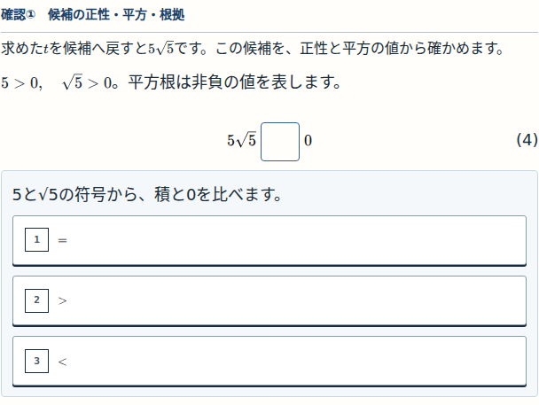
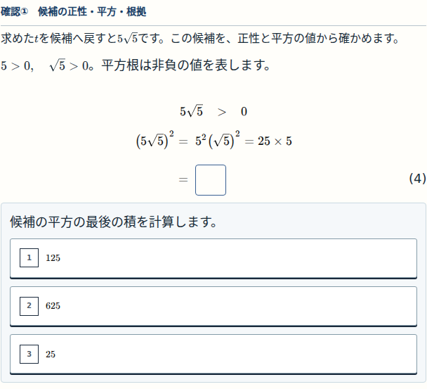
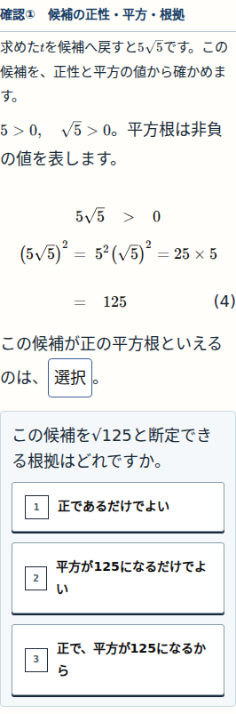
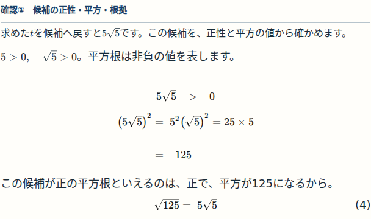
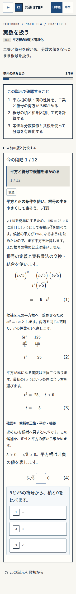
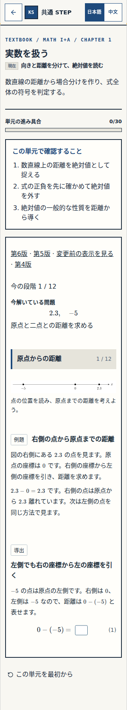

# 本人総チェック — 公開済みUX03

Status: USER-FINAL-CHECK-PENDING

[N09 第5版](https://rrikunagasige-dot.github.io/kyotsu-step-web/?v=db99a485#/learning/textbook/math-numbers-expressions-n09) / [N10 第4版](https://rrikunagasige-dot.github.io/kyotsu-step-web/?v=db99a485#/learning/textbook/math-numbers-expressions-n10)

公開・実配信検証と非作者の対象表示審査はPASSです。本人が両教材の排版・穴の流れ・選択肢・左下resetを実物で操作し、受入可／要修正を判断する段階です。公開承認「いいよ」を、この品質受入へ転用しません。

[実配信検証](VERIFICATION.md) / [公開run](https://github.com/rrikunagasige-dot/kyotsu-step-web/actions/runs/41389935781)。以前の確認①は履歴で、再承認依頼ではありません。

---

# 最新状態 — 代表確認後の続行を実施済み

Status: FULL-REVIEW-PASS / PUBLICATION-APPROVAL-PENDING

代表実画像提示後の本人「那继续做」を受け、残り16箇所まで実装・検査しました。以下の確認①は過去の代表ブロック票であり、現在の再承認依頼ではありません。

現在の確認対象は[公開用PR #134](https://github.com/rrikunagasige-dot/kyotsu-step-web/pull/134)です。[最新検証](VERIFICATION.md)と[全実画像・原FAIL証拠](https://chatgpt.com/library?file_id=libfile_5f3990a90e00819188f0cb550e908fff&account_id=personal)を参照してください。公開と本人最終受入は未実施です。

---

# 確認① — √125の代表ブロック

Status: BLOCK-CHECK-PENDING
Work: W-MATH-046 / 承認済みP-W046-UX-03
Block: n10-q02-sign → n10-02（H07）
Source SHA: [`830b620b343112e4f8c4e3d00b51461dc8ecc098`](https://github.com/rrikunagasige-dot/kyotsu-step-web/commit/830b620b343112e4f8c4e3d00b51461dc8ecc098)
N10 r4 compiledHash: `5f42dba655ce6dad1348dcf6cce705138fc7c266240277ad769d22be82f24f2b`

今回は承認案で定めた代表ブロックの確認です。残り16箇所の穴変更はまだ適用していません。確認①は撮影時の注記で、本文・数式・選択肢はこのSHAの実画面です。

見てほしい点は次の4点です。

1. N08と同じ小さな段階帯・番号枠付きの縦選択肢・左下リセットになっているか。
2. 本文と計算がつながって読みやすく、同じ式や条件の直後再掲がないか。
3. 正性→平方の計算→平方根と断定する理由を順に答え、正答後に結論が一度だけ出るか。
4. スマホでも式・穴・選択肢の配置が読みやすいか。

**返答は「確認①：細部OK」または「確認①：要修正」でお願いします。**

## 穴を選ぶ前（1440px）

## 平方の計算（1440px）

## 理由を考える（320px）

## 正答後（1440px）

スマホ全体・左下resetとN08基準を比較する

今回のN10全体（320px）：

変更していないN08の基準（320px）：

四つの画面幅の画像・技術検証

| 幅 | 未回答 | 平方 | 理由 | 正答後 |
|---|---|---|---|---|
| 320px | [画像](evidence/ux03-pilot/320-initial.png) | [画像](evidence/ux03-pilot/320-square.png) | [画像](evidence/ux03-pilot/320-reason.png) | [画像](evidence/ux03-pilot/320-complete.png) |
| 390px | [画像](evidence/ux03-pilot/390-initial.png) | [画像](evidence/ux03-pilot/390-square.png) | [画像](evidence/ux03-pilot/390-reason.png) | [画像](evidence/ux03-pilot/390-complete.png) |
| 430px | [画像](evidence/ux03-pilot/430-initial.png) | [画像](evidence/ux03-pilot/430-square.png) | [画像](evidence/ux03-pilot/430-reason.png) | [画像](evidence/ux03-pilot/430-complete.png) |
| 1440px | [画像](evidence/ux03-pilot/1440-initial.png) | [画像](evidence/ux03-pilot/1440-square.png) | [画像](evidence/ux03-pilot/1440-reason.png) | [画像](evidence/ux03-pilot/1440-complete.png) |

120回帰・生成器8件・型/変更TS lint/buildと、四幅の52parts/各102誤答・保存/reset/旧版・移行の検査はPASS。H07の意味と20実画像は非作者審査済み。finite-mathは意味審査対象31件が残るPARTIAL、全体governanceは既存の他Work記録不整合が残るFAILで、全体合格・公開可とはしていません。詳細は[VERIFICATION.md](VERIFICATION.md)。

画像の出所・hash：[PROVENANCE.json](evidence/ux03-pilot/PROVENANCE.json)。本人の細部OKと、実装承認・公開許可・最終アプリ受入は区別します。

