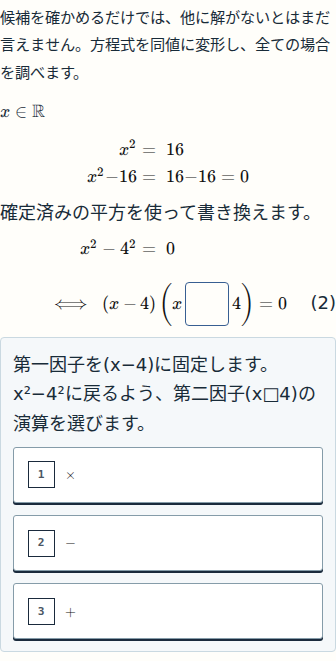
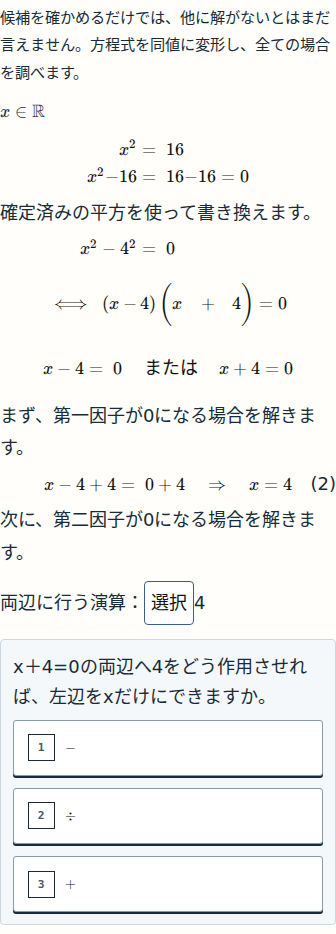

# 確認 — UX04 N09代表ブロック

Status: WAITING_USER_DETAIL_REVIEW
対象コード：[66c8007b37cc12391c9df574b8ebbb1b95cf26f5](https://github.com/rrikunagasige-dot/kyotsu-step-web/commit/66c8007b37cc12391c9df574b8ebbb1b95cf26f5)
N09第6版pilot / compiledHash `470f137102936e6bb73ca3df835e8c9b27d19c5ce53a40879fe9c2dfa8499a3d`

UX04の実装承認は受領済みです。今回は、その案で定めた最初の代表ブロックの**細部OK／要修正**の確認です。新しい設計全体への再承認ではありません。まだ公開していない候補で、公開中のN09第5版/N10第4版はそのままです。

写真の場面を、次の判断を自分で行う導出へ変えました。

- 負数の平方：累乗が作用する対象 → 積の符号 → 平方値。
- 全解の導出：両辺への演算 → 因数の符号 → 零積の「または」 → 第一・第二の一次式それぞれの逆演算。

旧46回答は保持し、新しい6判断だけから再開できます。「または」を答えても、左右の一次式は自動で解答済みになりません。

## 390pxでの途中状態

因数分解では、第二因子の演算がまだ穴です。

第一の一次式を解いた後も、第二の一次式の逆演算は自分で選びます。

[負数の平方を始める状態](evidence/ux04-pilot/390-n09-q01-negative-powerAction-initial.png) / [両方を解いた状態](evidence/ux04-pilot/390-n09-01-rightInverseOperation-correct.png)

## 四つの画面幅

| 幅 | 累乗の対象 | 因数分解の穴 | 第二の逆演算 | 完成 |
|---|---|---|---|---|
| 320 | [画像](evidence/ux04-pilot/320-n09-q01-negative-powerAction-initial.png) | [画像](evidence/ux04-pilot/320-n09-01-factorSign-initial.png) | [画像](evidence/ux04-pilot/320-n09-01-leftInverseOperation-correct.png) | [画像](evidence/ux04-pilot/320-n09-01-rightInverseOperation-correct.png) |
| 390 | [画像](evidence/ux04-pilot/390-n09-q01-negative-powerAction-initial.png) | [画像](evidence/ux04-pilot/390-n09-01-factorSign-initial.png) | [画像](evidence/ux04-pilot/390-n09-01-leftInverseOperation-correct.png) | [画像](evidence/ux04-pilot/390-n09-01-rightInverseOperation-correct.png) |
| 430 | [画像](evidence/ux04-pilot/430-n09-q01-negative-powerAction-initial.png) | [画像](evidence/ux04-pilot/430-n09-01-factorSign-initial.png) | [画像](evidence/ux04-pilot/430-n09-01-leftInverseOperation-correct.png) | [画像](evidence/ux04-pilot/430-n09-01-rightInverseOperation-correct.png) |
| 1440 | [画像](evidence/ux04-pilot/1440-n09-q01-negative-powerAction-initial.png) | [画像](evidence/ux04-pilot/1440-n09-01-factorSign-initial.png) | [画像](evidence/ux04-pilot/1440-n09-01-leftInverseOperation-correct.png) | [画像](evidence/ux04-pilot/1440-n09-01-rightInverseOperation-correct.png) |

## 検証と出所

136件の主回帰、最終の式group調整後の関連76件、型・変更lint・buildが合格。移行10ケースでは旧回答・時刻・回数・reset後の回答を保護し、未知版は保存を変えず拒否します。N10の教材と生成結果は不変です。

最終版は四幅128状態・1192幾何、各幅全52正答と代表8partの全14誤答候補、reload・履歴・旧版・reset・N08比較を確認。撮影前276回のfont確認でMain/Math-Italicの実loadedを要求し、AMSもloaded、HTTPエラー0・通信失敗0です。raw sourceSHAは撮影working treeの基準778a6c3aで、未commitだった承認変更20fileを候補66c8007bのGit blobと全件照合して同一byteと確認しています。撮影中のsource manifest前後も一致します。

[出所・manifest](evidence/ux04-pilot/PROVENANCE.json) / [browser原結果](evidence/ux04-pilot/BROWSER_RESULT.json) / [移行原結果](evidence/ux04-pilot/MIGRATION_RESULTS.json) / [全108画像と原計測ZIP](evidence/ux04-pilot/FULL_SCREENSHOTS.zip)

初回の文字接触、font403によるfallback画像、別bundleの出所検証拒否、旧test期待の失敗は履歴として保存し、正常フォントの最終合格へ混ぜません。非作者の[移行・コード審査](evidence/ux04-pilot/SOURCE_REVIEW.md)と[数学・表示審査](evidence/ux04-pilot/RENDER_REVIEW.md)は代表範囲で合格しました。本人の細部OK・全体受入・公開・Gold/fitはまだ認定していません。

確認後の次工程：細部OKなら、承認済みUX04の残り24箇所へ限定適用します。要修正なら、この代表の指摘から同型箇所を確認して戻します。これは[承認済み案のVerification Plan](PROPOSAL.md#verification-plan--修正ワークフロー)で定めた代表確認です。
