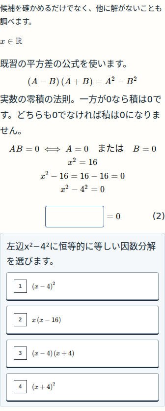
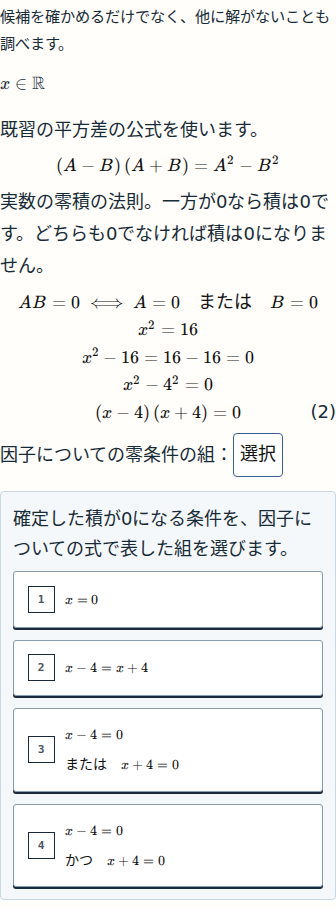
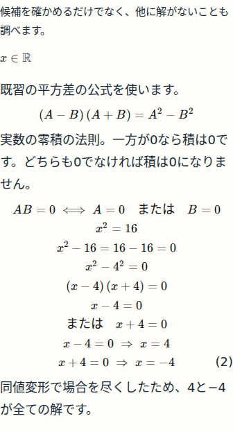

## 最新：UX06 和の平方代表（2026-11-03 JST）

[実画像付き確認票](evidence/ux06-pilot/REVIEW.md)。source a98640fd…、BLOCK-CHECK-PENDING。以下は過去の確認記録。

# 確認①〜③ — UX05代表ブロック

状態：**本人細部確認待ち**。これは公開前の候補の実画面です。

対象：N09「x²=16を満たす全ての実数」／`n09-q01-negative`・`n09-01`。固定source [`a39bdb8c9d064e6d90c8352020824bb5be4f931f`](https://github.com/rrikunagasige-dot/kyotsu-step-web/commit/a39bdb8c9d064e6d90c8352020824bb5be4f931f)、N09第7版 compiled `dedfd7c553c2c0186bf7bdbc881bba51649741dbe330e0c854c11dce7822a813`。以下はそのclean別worktreeの実アプリから撮影した元PNGで、合成・描き直しではありません。

## 確認① 因数分解を自分で作る

移項などの基本操作は途中式として示し、`x²−4²`から因数分解の式を選びます。具体的な因数分解を先に表示しません。

## 確認② 積から二つの零条件を作る

`(x−4)(x＋4)=0`から **`x−4=0 または x＋4=0`という条件の組**を選びます。「または」一字や、単純な移項だけを採点する設計を改めました。一般則は教え、その具体適用を生徒に残します。

## 確認③ 正答後の普通の数式と導出のつながり

正答した式は通常の組版へ戻り、二つの零条件→それぞれの解→全解という順につながります。`x＋4`だけ括弧が巨大になったり操作用の空きを残したりしないことをご確認ください。

[共通ページを含む390pxの全体実画像](evidence/ux05-pilot/images/390-n09-01-stage-completed.png)。

|画面幅|因数分解前|零条件を選ぶ時|正答後|
|---|---|---|---|
|320px|[実画像](evidence/ux05-pilot/images/320-n09-01-factorisedFormUX05-initial.png)|[実画像](evidence/ux05-pilot/images/320-n09-01-factorZeroConditionUX05-initial.png)|[実画像](evidence/ux05-pilot/images/320-n09-01-factorZeroConditionUX05-correct.png)|
|390px|[実画像](evidence/ux05-pilot/images/390-n09-01-factorisedFormUX05-initial.png)|[実画像](evidence/ux05-pilot/images/390-n09-01-factorZeroConditionUX05-initial.png)|[実画像](evidence/ux05-pilot/images/390-n09-01-factorZeroConditionUX05-correct.png)|
|430px|[実画像](evidence/ux05-pilot/images/430-n09-01-factorisedFormUX05-initial.png)|[実画像](evidence/ux05-pilot/images/430-n09-01-factorZeroConditionUX05-initial.png)|[実画像](evidence/ux05-pilot/images/430-n09-01-factorZeroConditionUX05-correct.png)|
|1440px|[実画像](evidence/ux05-pilot/images/1440-n09-01-factorisedFormUX05-initial.png)|[実画像](evidence/ux05-pilot/images/1440-n09-01-factorZeroConditionUX05-initial.png)|[実画像](evidence/ux05-pilot/images/1440-n09-01-factorZeroConditionUX05-correct.png)|

## 検証と次の工程

既存CODEと担当別審査、四幅の正誤/保存操作を完了しました。普通式の実寸との比較で見つかった5pxの内部余白も補修し、全四幅で一致しています。[検証結果と限界](evidence/ux05-pilot/SUMMARY.json)／[表示の非作者審査A](evidence/ux05-pilot/IMAGE_REVIEW_A.md)／[学習判断の非作者審査B](evidence/ux05-pilot/IMAGE_REVIEW_B.md)／[全原証拠ZIP](evidence/ux05-pilot/RAW_EVIDENCE.zip)。

現在地は[工程入口](WORKFLOW_CURRENT.md)の **④本人細部確認**。`細部OK`なら承認済み残り23箇所の限定適用→検証・横断監査へ進みます。`要修正`ならその指摘を記録し、対応する原因/具体案の工程へ戻ります。これはUX05案の再承認・公開許可・全体受入の依頼ではありません。
