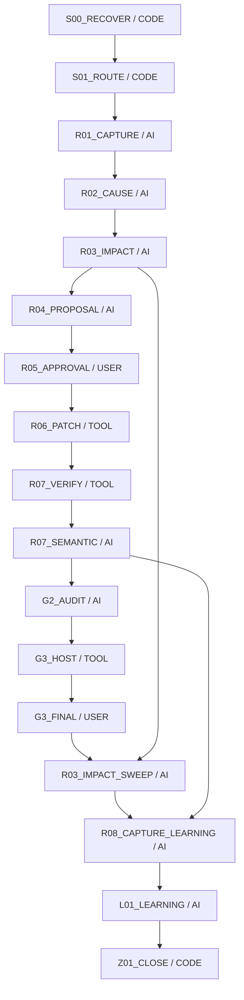

# W046 工程入口と現在地

このファイルを再開時の入口とし、工程ごとに下記正本へ進む。新しい実行器や工程を作る文書ではない。既存の配置図を出所付きで参照・再掲し、今回の現在地だけを対応させる。

## 出所と優先順位

- 対象repo：rrikunagasige-dot/kyotsu-step-web（1391122224）。工程実装/配置図の参照版：Work commit `3323ed599f621f45ffde4563f92f132cdd387d50`。
- [既存配置図](../W-GOV-011-solution-production/WORKFLOW_PLACEMENT.md)・[詳細入口](../../../workflow/INTEGRATION_RUNBOOK.md)・[機能配置の実装](../../../workflow/capabilities.py)・[DAGの実装](../../../workflow/graphs.py)。Work版runbookはmainに未存在であり、main採用済みとは記さない。
- 教材の承認・細部確認・公開権限は[main WORK_SYSTEM§11/12A](https://github.com/rrikunagasige-dot/kyotsu-step-web/blob/6bc54447ef015a2a579a56a5966ceb58a0600d3a/governance/WORK_SYSTEM.md#L246)（blob b4a03e8443d6595f872e6a9316c54633c3275562）と承認済みUX05を優先。Work版P004の「G1不要/公開再許可不要」をW046へ移植しない。

## 現在地

UX05固定案の明示承認を受領：[原発言と範囲](evidence/ux05-proposal/APPROVAL.json)。同じ案を聞き直さない。

- 実質の現在地：①既存CODE接続と意味応答import、②承認照合と代表実装、③固定候補R07検証/非作者実画像審査まで完了。④本人細部確認は本人『承認继续。』で **BLOCK-VISUAL-OK**。現在は残り23CHANGEのR04 CODE対応→R06限定適用→R07→G2へ進む。[受領記録](evidence/ux05-full/DETAIL_ACCEPTANCE.json)。新しい要修正があれば原因/具体案へ戻る。source a39bdb8c、実績/限界はevidence/ux05-pilot/SUMMARY.json。CODEのNEEDS_AI_REVIEW原結果とAI importを別に保持する。
- 正式台帳上のPASSEDやnext-nodeは未認定。既存26イベント欠落の本人特例を保持し、新しい空Store・架空receipt・旧工程の再合格で埋めない。
- 下記の図は既存実装定義の配置図であり、W046最新Storeから生成した実行状況図ではない。W034や技術Workのgenerated図をW046の完了証拠へ転用しない。

## 本適用の版と保存

本人確認済みN09r7 pilotは固定保存し、本適用はN09r8（from7）/N10r5（from4）。UX05の数学/学習契約は変えず、同じrevisionの異なるartifactへ回答を黙って流用しないための保存判断。旧全revision/hashの鎖、KEEP/RETIRE/NEWと新gateを厳密に照合する。

## 今回の実行順

着手/完了時にこの図の現在地と次手を照合。今回R07で実寸FAIL→R06のmarker限定補修→新source R07再確認の復帰を記録した。正式Storeの受理状態とは区別する。

|工程|使う既存CODE/入力・出力|主担当と非作者審査|次へ進む条件|
|---|---|---|---|
|R04不足の照合|承認案を既存N0910 NODE_DESIGN/IR/組立・配置契約へ対応。capabilitiesの版・facet・opt-in条件を確認。math.solve/verify、teaching.plan/step.plan/blank.plan、interaction.plan、construction/layout.validate等の適用入力を特定して実行可能な経路へ渡す|Mが対応と入力を固定。Aが数学/主判断、Bが組版/操作の適用を反証。未知法則の教授と具体適用、必要計算、先出しを確認|全必要処理に入力・既存実装・出力・未対応の扱いがある。独自のID集計だけで代用しない。承認済み内容不変なら再承認不要|
|R05照合|proposal commit/hash/範囲をAPPROVALと照合。承認原文は転記証拠として保持|Mが照合。AI/審査合意を本人承認にしない|同じ具体案に有効な承認がある|
|R06代表|まずn09-q01-negative/n09-01と必要な共有renderer。既存source-bound generator：NODE_DESIGN→nested-lesson→compileTransformationV3→validateCompiledNestedLesson→compiled/revision/pins。`apply-n0910-construction.mjs`の対象指定で他unit書換えを限定|Mが限定実装。Aは数学/保存、Bは数式AST/状態別寸法/操作を非作者審査|同一source・設計・compiled・pinが結び付き、変更は承認範囲内|
|R07 CODE|既存validate-design/finite-math/compiled validator、関連回帰、型/build、実browser。320/390/430/1440の未回答/誤答/部分正答/完成、実font、source-bound geometry、保存/履歴/移行を確認|CODEのFAIL/UNSUPPORTEDを保持。Mが結果を関連証拠へ対応|必要検査成功。対応外の数理は根拠付きAI審査へ明示接続|
|R07意味審査＋代表細部確認|同じ候補SHAの実画像/可視stateを使用。正答後通常AST・主判断・未来答え・小問過剰を確認|A/Bが作者を避けて審査、M統合も対象。本人に代表確認票を提示|main§12Aの本人細部OKを得る。テストPASSから推測しない|
|残りの限定適用→G2|代表OK後、承認表の残りCHANGEへ同じ方式。protected.verify/impact.inventoryと実差分でKEEP/他unit/旧版を確認|Mが統合、A/Bが各担当の非作者監査|新しい重大指摘は修正へ戻す。86node監査済みを実装後全合格に読み替えない|
|G3→R03事後→R08/L01→Z01|既存公開経路とrelease.verify、実配信byte/実操作、事後同型確認、case.finalize、適用条件を満たす場合だけml.train|公開は別具体的承認、本人が合意範囲を実物評価。学習は評価証拠を使用|本人受入・事後確認・事例更新の必要条件を満たす。承認をGoldにせず、OFFLINE_ONLY/ABSTAINを保持|

**CODEの役割は検査だけではない。** 既存サービスは資料/事例の取得、既習台帳、対応範囲付きの解法、教授順/段階/穴の候補、本文/IR/数式/配置の生成と検査、可視情報、担当収集、差戻し・失効・承認照合、事例化にも接続する。ただし登録名だけで全処理を自動実行済みにせず、AI request/import型の処理・未対応・opt-in条件を区別する。

## 実行器と図の使い方

`workflow/cli.py`の`next`がCODE/AI/USER/TOOLを返す。`auto`は実行可能CODEと有効承認の照合だけを進め、AI結果や本人評価を作らない。適用するStore/planが有効な場合に`production-run`で必要capability、`production-ai`で判断課題を取得し、実担当の根拠付き結果をsubmit/production-resultへ戻す。team/1の有効planでは実task→原報告→非作者/hash確認→collectionを既存CODEで検査する。

有効な同一Storeから`render`で三階層図（FIRE_DIAGRAM/BLOCK_FIRE_DIAGRAM/CAPABILITY_FIRE_DIAGRAM）とsnapshotを生成し、`render --check`で相違を検出する。台帳の読取可否を確認せずCLIを起動するとStore作成を伴い得るため、欠落したW046へ空のStoreを作らない。現在は例外継続の証拠とこの入口を使い、正式図の生成成功は主張しない。

旧planのproduction/2・solution/1・construction-layout/1・team/1・nested-math/1のflagは推測しない。既存nested教材がn0910/1であることとRuntime planのopt-in有効性は別。必要なadapter/互換範囲はR04不足照合で確定し、工程基盤の無断変更はしない。

## 既存修正配置図の再掲

以下はW-GOV-011 WORKFLOW_PLACEMENT.mdの修正節をそのまま再掲。W046のPASS状況ではない。具体的な機能条件は上記capabilities.pyと詳細仕様へ進む。

| 工程 | 主担当 | 工程内のCODE機能 |
|---|---|---|
| S00_RECOVER | CODE | — |
| S01_ROUTE | CODE | — |
| R01_CAPTURE | AI | source.fixed, feedback.capture |
| R02_CAUSE | AI | case.retrieve, knowledge.ledger, math.verify, ir.verify, source.audit, novice.audit, math.solve, solution.validate |
| R03_IMPACT | AI | impact.inventory |
| R04_PROPOSAL | AI | math.solve, math.verify, teaching.plan, step.plan, blank.plan, prose.compose, text.verify, figure.verify, ir.verify, source.audit, novice.audit, solution.validate, interaction.plan, solution.review |
| R05_APPROVAL | USER | — |
| R06_PATCH | TOOL | ir.compile, render.solution |
| R07_VERIFY | TOOL | math.verify, ir.verify, browser.verify, protected.verify, solution.validate |
| R07_SEMANTIC | AI | source.audit, novice.audit, solution.review |
| G2_AUDIT | AI | protected.verify, impact.inventory |
| G3_HOST | TOOL | release.verify |
| G3_FINAL | USER | — |
| R03_IMPACT_SWEEP | AI | impact.inventory |
| R08_CAPTURE_LEARNING | AI | case.finalize |
| L01_LEARNING | AI | case.finalize, ml.train |
| Z01_CLOSE | CODE | — |

AIが主担当の工程でもCODE receiptを先に取り込み、意味の判断は根拠付きで別提出する。USERは依頼・既承認・実物評価。TOOLは既存実装/公開操作で、CODEによる意味の自動合格ではない。
