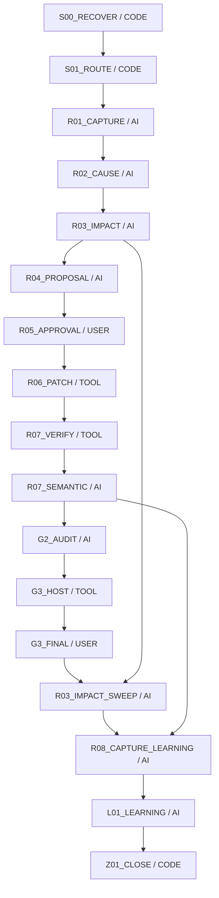

# W046 工程入口と現在地

このファイルを再開時の入口とし、工程ごとに下記正本へ進む。新しい実行器や工程を作る文書ではない。既存の配置図を出所付きで参照・再掲し、今回の現在地だけを対応させる。

## 出所と優先順位

- 対象repo：rrikunagasige-dot/kyotsu-step-web（1391122224）。工程実装/配置図の参照版：Work commit `3323ed599f621f45ffde4563f92f132cdd387d50`。
- [既存配置図](../W-GOV-011-solution-production/WORKFLOW_PLACEMENT.md)・[詳細入口](../../../workflow/INTEGRATION_RUNBOOK.md)・[機能配置の実装](../../../workflow/capabilities.py)・[DAGの実装](../../../workflow/graphs.py)。Work版runbookはmainに未存在であり、main採用済みとは記さない。
- 教材の承認・細部確認・公開権限は[main WORK_SYSTEM§11/12A](https://github.com/rrikunagasige-dot/kyotsu-step-web/blob/6bc54447ef015a2a579a56a5966ceb58a0600d3a/governance/WORK_SYSTEM.md#L246)（blob b4a03e8443d6595f872e6a9316c54633c3275562）と承認済みUX05を優先。Work版P004の「G1不要/公開再許可不要」をW046へ移植しない。

## 現在地

本人page `89b9b8f8-6ab7-4bd2-bbda-72da611e4257` の最新指示：reset後に未回答の空欄を確認し、設計への指摘を撤回。N09/N10の段落だけを修正し、それが済めば全体を通せるという条件付き受入。回答済み表示を穴欠落と誤認した前pageのスクリーンショットを、新規穴設計の根拠にしない。

- 修正ループ R01/R02/R03→R06→R07。表示source `6b439d0d31fcd46708c256ed23a391009ab73164` は既公開d588からrenderer/CSSの2パスのみ変更。本文token・数学・穴・gate・compiled・revision・保存namespaceを保持。
- Mが意味境界を指定、Aが数学/保存と公開2パスbyte差分を非作者審査、Bが理念/工程と実画像を監視。既存CODEで型/対象lint/21回帰と4幅88画像を検査。公開PR137のCI/governance成功。画像最終審査後にG3_HOSTへ進み、公開後の実配信byte/操作確認を行う。RUNNINGを公開成功と記さない。
- 前回公開d588/publisher e734/run41569692346の技術成功証拠は履歴として保持。今回sourceの成功へ流用しない。
- 本人ブラウザのBrowser接続はoriginating browser context不足で失敗。検証contextのresetと本人端末のresetを区別する。全員自動reset・namespace変更はしない。
- 正式Storeの26イベント欠落に関する本人特例は保持。空Store・架空receipt・正式PASSED/next・Gold/fitを作らない。

## 最新照合（2026-11-03 JST）

R03の全86設計の個別記録・主担当の反証・A/B訂正は[統合報告](evidence/ux05-full-re-audit/ROOT_REVIEW.md)へ保存。続くR04は下記UX06案を作成。これはR03/R04時点の履歴。最新の実装・検査状態は上記現在地を優先。正式Storeのnext認定ではない。

## R04具体案の経緯（UX06履歴 / 2026-11-03 JST）

[案の確認入口](evidence/ux06-proposal/README.md)・[厳密なR04必須項目](evidence/ux06-proposal/R04_RESULT.json)。本人の案作成指示で、Aの数学/保存審査とBの理念/工程監視を実施。Bはroot案の旧条件からの先出し等を指摘し、実公開モデルで再照合。新案は[承認済み](evidence/ux06-proposal/APPROVAL.json)。代表限定実装後、本人の条件付き細部承認を補修・検査で充足し、本適用へ進んだ。公開は未実施。native/数学/教授CODEの限定結果とUNSUPPORTED/NEEDS_AI_REVIEW/NOT_RUNは案に明記。正式Store PASSEDやnext生成は未認定。

今回の案の代表は**n09-decimal-methodの和の平方導出**。下表の旧UX05でのq01代表順序は履歴であり、新案にはこの指定を優先する。R05/R06代表は実施、R07 CODE/意味/実画像の限定結果は[検査記録](evidence/ux06-pilot/VERIFICATION.json)。条件付き本人細部承認を充足して残り限定適用を実施。本文CODE補完・影響G2再統合済み。既存の画像・操作の限定合格は保持し、この時点ではG3のローカル公開前準備と別公開承認を待った（履歴）。最新は上記G3_FINAL。小ブロックごとにこの入口とMASTER§52を照合する。

## 本適用の版と保存

UX05のN09r7 pilot/r8・N10r5を固定保存。UX06代表はN09r9（from8）、条件付き本人細部OKを充足した本適用はN09r10（from9）/N10r6（from5）。UX05の数学/学習契約は変えず、同じrevisionの異なるartifactへ回答を黙って流用しないための保存判断。旧全revision/hashの鎖、KEEP/RETIRE/NEWと新gateを厳密に照合する。

## 今回の実行順

着手/完了時にこの図の現在地と次手を照合。今回R07で実寸FAIL→R06のmarker限定補修→新source R07再確認の復帰を記録した。正式Storeの受理状態とは区別する。

|工程|使う既存CODE/入力・出力|主担当と非作者審査|次へ進む条件|
|---|---|---|---|
|R04不足の照合|承認案を既存N0910 NODE_DESIGN/IR/組立・配置契約へ対応。capabilitiesの版・facet・opt-in条件を確認。math.solve/verify、teaching.plan/step.plan/blank.plan、interaction.plan、construction/layout.validate等の適用入力を特定して実行可能な経路へ渡す|Mが対応と入力を固定。Aが数学/主判断、Bが組版/操作の適用を反証。未知法則の教授と具体適用、必要計算、先出しを確認|全必要処理に入力・既存実装・出力・未対応の扱いがある。独自のID集計だけで代用しない。承認済み内容不変なら再承認不要|
|R05照合|proposal commit/hash/範囲をAPPROVALと照合。承認原文は転記証拠として保持|Mが照合。AI/審査合意を本人承認にしない|同じ具体案に有効な承認がある|
|R06代表|UX06はn09-decimal-methodと承認済みnative fontを代表限定実装。既存source-bound generator：NODE_DESIGN→nested-lesson→compileTransformationV3→validateCompiledNestedLesson→compiled/revision/pins。`apply-n0910-construction.mjs`の対象指定で他unit書換えを限定|Mが限定実装。Aは数学/保存、Bは数式AST/状態別寸法/操作を非作者審査|同一source・設計・compiled・pinが結び付き、変更は承認範囲内|
|R07 CODE|既存validate-design/finite-math/compiled validator、関連回帰、型/build、実browser。320/390/430/1440の未回答/誤答/部分正答/完成、実font、source-bound geometry、保存/履歴/移行を確認|CODEのFAIL/UNSUPPORTEDを保持。Mが結果を関連証拠へ対応|必要検査成功。対応外の数理は根拠付きAI審査へ明示接続|
|R07意味審査＋代表細部確認|同じ候補SHAの実画像/可視stateを使用。正答後通常AST・主判断・未来答え・小問過剰を確認|A/Bが作者を避けて審査、M統合も対象。本人に代表確認票を提示|main§12Aの本人細部OKを得る。テストPASSから推測しない|
|残りの限定適用→G2|代表OK後、承認表の残りCHANGEへ同じ方式。protected.verify/impact.inventoryと実差分でKEEP/他unit/旧版を確認|Mが統合、A/Bが各担当の非作者監査|新しい重大指摘は修正へ戻す。86node監査済みを実装後全合格に読み替えない|
|G3→R03事後→R08/L01→Z01|既存公開経路とrelease.verify、実配信byte/実操作、事後同型確認、case.finalize、適用条件を満たす場合だけml.train|公開は別具体的承認、本人が合意範囲を実物評価。学習は評価証拠を使用|本人受入・事後確認・事例更新の必要条件を満たす。承認をGoldにせず、OFFLINE_ONLY/ABSTAINを保持|

**CODEの役割は検査だけではない。** 既存サービスは資料/事例の取得、既習台帳、対応範囲付きの解法、教授順/段階/穴の候補、本文/IR/数式/配置の生成と検査、可視情報、担当収集、差戻し・失効・承認照合、事例化にも接続する。ただし登録名だけで全処理を自動実行済みにせず、AI request/import型の処理・未対応・opt-in条件を区別する。

## 実行器と図の使い方

`workflow/cli.py`の`next`がCODE/AI/USER/TOOLを返す。`auto`は実行可能CODEと有効承認の照合だけを進め、AI結果や本人評価を作らない。適用するStore/planが有効な場合に`production-run`で必要capability、`production-ai`で判断課題を取得し、実担当の根拠付き結果をsubmit/production-resultへ戻す。team/1の有効planでは実task→原報告→非作者/hash確認→collectionを既存CODEで検査する。

有効な同一Storeから`render`で三階層図（FIRE_DIAGRAM/BLOCK_FIRE_DIAGRAM/CAPABILITY_FIRE_DIAGRAM）とsnapshotを生成し、`render --check`で相違を検出する。台帳の読取可否を確認せずCLIを起動するとStore作成を伴い得るため、欠落したW046へ空のStoreを作らない。現在は例外継続の証拠とこの入口を使い、正式図の生成成功は主張しない。

旧planのproduction/2・solution/1・construction-layout/1・team/1・nested-math/1のflagは推測しない。既存nested教材がn0910/1であることとRuntime planのopt-in有効性は別。必要なadapter/互換範囲はR04不足照合で確定し、工程基盤の無断変更はしない。

## 既存修正配置図の再掲

以下はW-GOV-011 WORKFLOW_PLACEMENT.mdの修正節をそのまま再掲。W046のPASS状況ではない。具体的な機能条件は上記capabilities.pyと詳細仕様へ進む。

| 工程 | 主担当 | 工程内のCODE機能 |
|---|---|---|
| S00_RECOVER | CODE | — |
| S01_ROUTE | CODE | — |
| R01_CAPTURE | AI | source.fixed, feedback.capture |
| R02_CAUSE | AI | case.retrieve, knowledge.ledger, math.verify, ir.verify, source.audit, novice.audit, math.solve, solution.validate |
| R03_IMPACT | AI | impact.inventory |
| R04_PROPOSAL | AI | math.solve, math.verify, teaching.plan, step.plan, blank.plan, prose.compose, text.verify, figure.verify, ir.verify, source.audit, novice.audit, solution.validate, interaction.plan, solution.review |
| R05_APPROVAL | USER | — |
| R06_PATCH | TOOL | ir.compile, render.solution |
| R07_VERIFY | TOOL | math.verify, ir.verify, browser.verify, protected.verify, solution.validate |
| R07_SEMANTIC | AI | source.audit, novice.audit, solution.review |
| G2_AUDIT | AI | protected.verify, impact.inventory |
| G3_HOST | TOOL | release.verify |
| G3_FINAL | USER | — |
| R03_IMPACT_SWEEP | AI | impact.inventory |
| R08_CAPTURE_LEARNING | AI | case.finalize |
| L01_LEARNING | AI | case.finalize, ml.train |
| Z01_CLOSE | CODE | — |

AIが主担当の工程でもCODE receiptを先に取り込み、意味の判断は根拠付きで別提出する。USERは依頼・既承認・実物評価。TOOLは既存実装/公開操作で、CODEによる意味の自動合格ではない。

## 2026-11-03 本文CODE補完と今回の担当照合

本人page346968bd…の助言により、図→詳細手順→実装→入力/出力→担当の順を再照合。native構造validatorは既存compileでも実行されていたが、本文工程でのCODE適用照合・明示実行・公開本文再審査への接続を補完せずG2を先行集約したため、R07本文補完と影響G2へ戻り、[実結果](evidence/ux06-full/PROSE_CODE_CHECK.json)を統合した。文章生成helperを名目的に呼ぶ修正や新engineは作らない。

|担当|今回実行した責任と判断境界|
|---|---|
|主担当M|図の現在地/停止条件、具体手順と実装入口を照合。本文の目的・操作理由・次使用を起草しCODE入力へ対応。A/B所見と生結果を統合し次工程を報告|
|A|既習前提・数学的理由・作用対象・認定結果の再使用・保存を、実public本文から非作者審査|
|B|承上啓下/生徒が次に考える理由・表示と工程を監視。rootのG2完了記録不足と公開font検査不足も指摘|
|既存CODE|今回はS11/S12相当のverify-ir native分岐でsource/design/compiledと本文構造・参照/gateを照合。U07でpublic依頼生成と28応答のhash/契約を検査。G3では固定source/build/manifest/asset生byte/操作/font/HTTPを検査|

S11という名称だけで自動作文・自然言語の因果自動合格とは言わない。helper operationSentenceは別のproduction-ir/1のslot付き段落用で現nativeへ直接適合しないため、呼んで出力を捨てる利用はしない。CODE検査の範囲外をA/Bへ明示し、意味審査で埋める。

G3公開前準備時の履歴：exact d588隔離build/121assets/N0910四幅8cases、保持N08四幅（3936測定）・旧r6・旧版・N11四幅合格。[2file案/停止条件](evidence/ux06-full/G3_PREFLIGHT.json)。次はこの固定候補の公開承認→mainの公開設定2ファイルのみ適用→既存CI→実配信検証→本人実物評価。mainへの適用/Pages公開/最終本人受入は未実施。

## 2026-11-03 公開承認受領・G3実行の経緯（完了済み履歴）

[本人公開承認](evidence/ux06-full/PUBLICATION_APPROVAL.json)を受領。PR136はmainf4c基底、headc620、公開設定2filesのみ。check/governance成功を確認。次はexpected headでmerge→既存公開jobの前段検査→deploy→実配信byte/操作→G3本人実物評価。PR成功を公開済み/本人受入へ転用しない。

G3実行追記：PR136をexpected c620でmerge成功。main publisher e734337f1e18dd285f04f1b8ed63532ceff3b72f、公開run41569692346実行中。製品sourceはd588固定。旧公開source691dのHTTP200を新候補公開成功へ読み替えない。[生状態](evidence/ux06-full/PUBLICATION.json)。

## G3_HOST完了・次の本人ゲート

[PUBLICATION.json](evidence/ux06-full/PUBLICATION.json)：実公開source d588/publisher e734、公開run全32step成功、独立HTTP全121asset、CI artifact13200882841 raw両manifest一致。A/Bが境界込みで独立照合。次はG3_FINALで合意済み全N09/N10の本人実物評価。本人受入未了のままR08/L01/Z01やGold/fit完了へ進めない。NGは修正/同型監査へ戻る。
