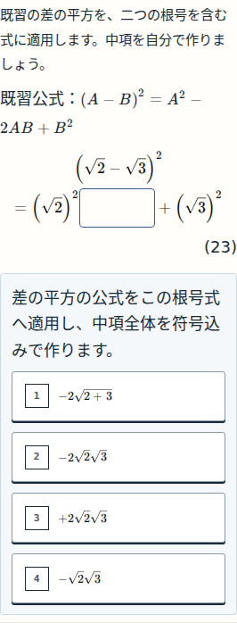
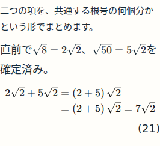

# UX05 本適用・検証記録

現在の正本はSUMMARY.jsonとCROSS_BLOCK_AUDIT.md。アプリ固定sourceは691d3d160493bf684ca8a31a22476d31d98caeec、公開PR135は別head6969af9dで本人承認待ちです。

REVIEW_GALLERY.htmlは最終実画面86枚を内包した一覧。GitHub上の画像表示例は次の2点です。全23変更の画像・未回答/誤答/完成・実DOM・4幅の原結果はRAW_EVIDENCE.zip内。ZIPの最終監査記録は取得時snapshotで、後から完成したwide審査・G2統合はこのディレクトリのrender-review-a/b.mdと各images-reviewed manifestを正本とします。

R04のCODE原結果NEEDS_AI_REVIEW/finite math PARTIALとAI根拠を混同しません。正式Store26イベント欠落の本人特例を保持し、正式PASSED receiptはありません。N09q07条件末尾の句点折返しはnonblocking観察として残っています。本人の最終アプリ受入・Gold・fitは未実施です。

再実行用browser.mjsは最新実行hashc9c2dc27のcollector、migration-executed.mjsは実24caseを走行した0bf24870。migration-browser.mjsはfilter DEBUG_ONLY/24assertを追加した後続補足版であり、過去実行をこの版へ偽装しません。各実行はrepo固定sourceをclean checkoutし、W046_SOURCE_ROOT/W046_EXPECTED_SHAと出力先を明示してください。公開操作は含みません。

公開workflowの古いW041包括CI断定コメントを訂正し、最終PR headは900644e0です。ZIPのpublisher snapshot/初回CI6969は履歴として保存、実行codeは同じです。最新の限定非作者確認はpublisher-review-b.md。
