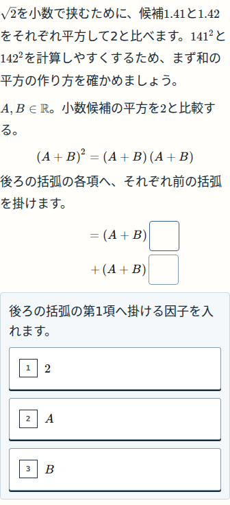
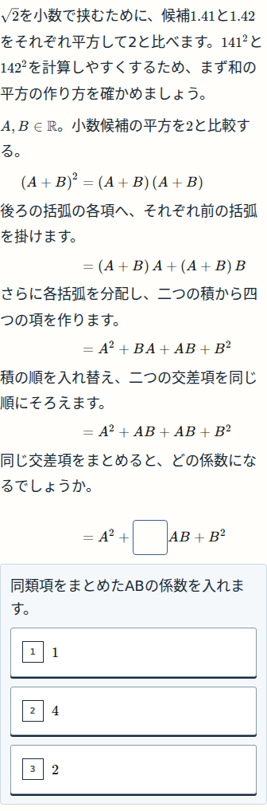
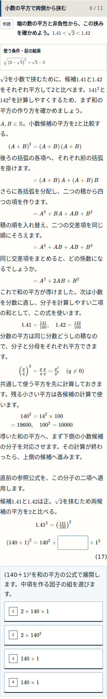

> 履歴の代表確認票。最新の本人条件付き細部承認は[DETAIL_ACCEPTANCE](../ux06-full/DETAIL_ACCEPTANCE.json)、本適用の現在地は[最新確認票](../ux06-full/REVIEW.md)を参照。以下の当時の待ち状態を現在へ流用しない。

# N09 和の平方 — 代表ブロックの確認票

Review: W046 / P-W046-UX-06  
Status: BLOCK-CHECK-PENDING  
Block: `n09-decimal-method`  
対象source: `a98640fd2757b2b9766cbbd085d16ea37ec437ad`  
N09第9版（代表）／未公開

今回は、和の平方を**因子→分配→四項→同類項**と自分で作る部分だけを確認します。文字・積の項・平方・係数を埋めます。正答すると通常の数式へ戻り、続く判断を操作できます。

## 確認① — 分配の因子を自分で入れる

**A・B、積の項、最後の平方を作り、導出を進める流れになっているか。** この画像の後に、BAとB²を式内で構成します。BAを正答する前にABへの言い換えを先出ししません。

## 確認② — 四項から中項をまとめる

**二つの交差項をそろえて係数を作る理由が、文章と式で追えるか。本文・数式・選択肢の大きさが揃って読みやすいか。** 完成公式は回答前の条件欄へ出しません。

## 確認③ — 具体的な平方計算へ戻る

**導出した式を具体的な計算へ使う流れになっているか。** この画像は、導出以前だけを解いたテスト記録から進めたものです。次の中項は未回答で、既存の中項・計算・小数化の判断が続きます。

**返信：`細部OK` または `要修正：確認②の……`**

細部OKはこの代表画面の確認です。その後、承認済みの残り10導出と3本文変更を限定適用し、横断検証・公開承認・アプリ総チェックへ進みます。

---

## 出所・内部検証

- mainの[確認票テンプレート（P-003）](https://github.com/rrikunagasige-dot/kyotsu-step-web/blob/f4c50963e26d3d4f9b33c3ca9f43e91e57dbdb75/work/templates/BLOCK_REVIEW_SHEET.md)とWORK_SYSTEM§12Aを使用。未採用Work側の内部QAテンプレートへ置き換えていません。
- 原資料：N09 Authored SHA256 `86733957a6b748b9e2d2609a0b95e1a3c765a8d82397dfbf27837d834539ad95`。UX06承認案SHA256 `a604ffa8f14499973ab5a3799bc1d4d3d605111883ba6046966d812fbacf3840`。
- compiledHash：`de799a4d1ab2db03d204e5024f33aab67cf36d6f8b217a28cdd2a959ebef10d4`。本体の変更は代表1node、native文字サイズ、保存/版接続。N09他40node・N10教材・積/商の証明9nodeは保持。
- 画像は隔離コピーの実アプリで取得。対象GitHub commitとsrc/public/build入口のGit tree/blob一致をAPP_SOURCE_IDENTITYで照合。原full-page PNG・切出し座標・個別hashを保存し、模擬UI画像は使っていません。確認①②は390px、確認③は390pxの実画面です。
- 確認①②は旧43回答を保持した移行シナリオ。確認③は導出以前だけを解いた記録で、次の具体計算が未回答のシナリオです。二つを混同しません。
- 実フォントはKaTeX_MainとMath italicのload/loaded/error0、HTTP error0を確認。親18pxだけでなくlead自身・本文内数式・条件・理由文・選択肢・独立式を計測。旧16px/代替fontの画像・不十分だった判定は履歴へ隔離。
- 115件の関連回帰、native9件、型・build・対象lint、5段階の恒等式検査、四幅88packet、保存/未知版6ケースを確認。Bの実画像・理念審査と既存CODEの6slot限定取込は別の証拠。正式Store受理、本人受入、全体公開の合格を意味しません。
- [検査結果](VERIFICATION.json) / [数学・保存の非作者審査](REVIEW_A.md) / [理念・実画像監視](REVIEW_B.md)。本人の返答は未受領で、この票はBLOCK-CHECK-PENDINGのままです。
