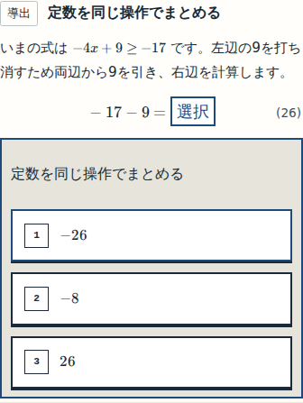
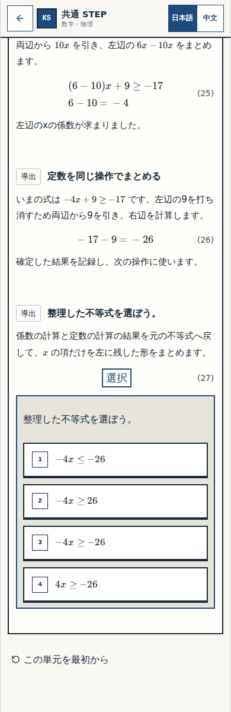

# N11の細部確認 — 定数の計算から元の不等式へ

Review: W-MATH-047 / P-W047-06  
Status: BLOCK-CHECK-PENDING  
Block: n11-q11-constant → n11-11  
実際に検査・撮影したsource SHA: `4a09de7a0f910669946466daf918ab28c820a5f2`  
原資料: W036の位置付き原文、word-p-000507〜000508。教材revision11、採点・保存・式番号は維持。  
実画像: 成功した[GitHub Actions 41620137341](https://github.com/rrikunagasige-dot/kyotsu-step-web/actions/runs/41620137341)、artifact13223652318。390px、focus画像と通常viewport390×1200。画像原本の教材やCSSに加工なし。番号は本票の見出し。

## 今回ここを確認してください

### 確認① — まず自分で定数部分を計算する

「−17−9」に空を残しています。ここで次の不等式全体まで完成させない形です。

### 確認② — 計算結果を使って、不等式全体へ戻る

上に確定した「−26」を残し、次は不等式全体を自分で選びます。この順序と、式・番号・選択肢の並びが読みやすいかを見てください。

**返信：`細部OK` または `要修正：確認①／②の…`**

この返信は今回の画面の細部確認です。公開後の実アプリの操作・受入は別に行います。教材内容やCI設定の追加承認を繰り返すものではありません。

## 検証と次の工程

- 専用CI成功。各320/390/430/1440pxでN11全39正答・109誤答候補、履歴・再読込・旧保存の移行が合格。
- 数理33件、既存の現在版behavior4件、build、原図・W038表示・採点・式番号の保持を確認。
- 原資料・実画像の非作者審査を登録し、R07_VERIFY/R07_SEMANTICは正式PASS。最初のCI画像の遮蔽指摘CI-V06は履歴に残し、通常viewportの画像でVERIFIED_FIXED。
- N12は現在BASELINE。承認済み5箇所の本体適用はまだ行っていません。
- 火柴図の次はG2_AUDIT@n11。その提出前に、現行main WORK_SYSTEM§12A Gate①の本人細部確認を記録します。Work版の内部QAテンプレートでこの規則を上書きしません。
- 公開・最終アプリ受入は未実施です。

[火柴図の現在地](generated/CURRENT_POSITION.md) / [実CIの出所・画像hash](evidence/ci/41620137341/CAPTURE_PROOF.json)

規範：[現行main WORK_SYSTEM§12A](https://github.com/rrikunagasige-dot/kyotsu-step-web/blob/04b823259a0873235e39099864d454330eed5d81/governance/WORK_SYSTEM.md#L301)、[同版の確認票テンプレート](https://github.com/rrikunagasige-dot/kyotsu-step-web/blob/04b823259a0873235e39099864d454330eed5d81/work/templates/BLOCK_REVIEW_SHEET.md)。
