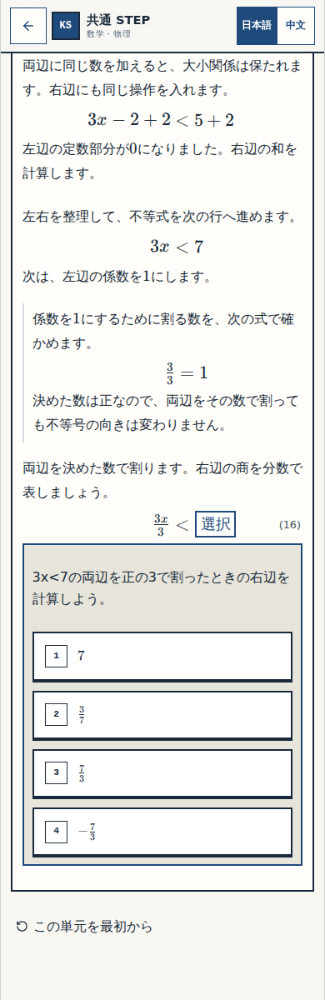
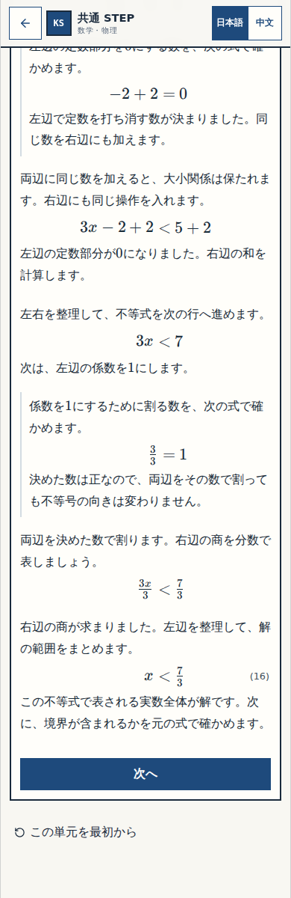

# N11 修正版の画面確認

Status: BLOCK-CHECK-PENDING。Work W-MATH-047 / 承認案 W047/G2-R1。

対象block: `n11-06`。表示row: `n11-tg-divide` → `n11-tg-final`。実装source: `2b7780b97bf8c3bde463742e71bf3e816ea8b562`。

## 確認① — 商を自分で作る

式(16)の右辺が選択の空になっています。この時点では、完成した `x < 7/3` を本文へ出しません。

見る点：直前の式から答えを写す形にならず、決めた除数を使って右辺の商を自分で作れるか。

## 確認② — 正答後に完成式へつなぐ

商を答えた後、「右辺の商が求まりました。左辺を整理して…」から完成した範囲へ進み、次の境界確認へつながります。

見る点：除算→左辺の整理→完成範囲→元の式で境界を確認、の流れが自然か。

**返信は「細部OK」または「要修正（気になる箇所）」でお願いします。** 二箇所の画面確認であり、公開や最終アプリ受入の承認ではありません。

## 検証の出所と次工程

[専用CI41635935097](https://github.com/rrikunagasige-dot/kyotsu-step-web/actions/runs/41635935097)の実artifact13231101167。原ZIP SHA256 `0876cffba4984786b09cd3a4f2e12facdcaf4c448e1d93e436a12fc921a416da`、raw112件を照合。画像は固定sourceの実アプリ由来で、未適用ローカル候補の写真に差し替えていません。

N11全39正答/109誤答候補×320/390/430/1440、保存・再読込・履歴・旧rev1〜10移行、resetと先頭再読込、N11→N12/戻りは390pxで確認。N12はBASELINE全46回答/127誤答候補×四幅の保持検証で、承認済み5箇所の変更は未適用です。独立数学33件・既存操作4件・build、Aの実CI初回意味審査とBの原画像/hash補足照合を記録しました。旧版固定CI二本の失敗は原ログ保持、全repository CIを合格とは称していません。

火柴図の正式な次nodeは `G2_AUDIT@n11`。現行main WORK_SYSTEM§12Aに従い、この修正版Gate①の返信を記録してからG2再監査へ進みます。G2-B-L01の実症状は解消確認済み、統合監査上の正式閉鎖はG2に留保。未公開・最終アプリ受入前です。
