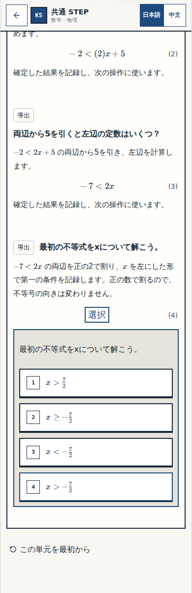
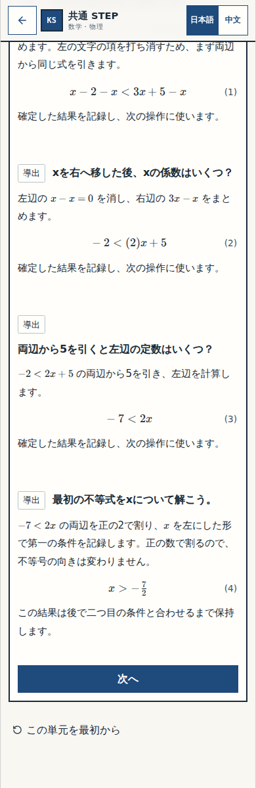
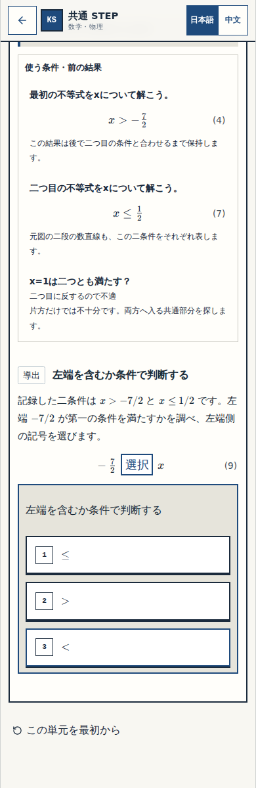
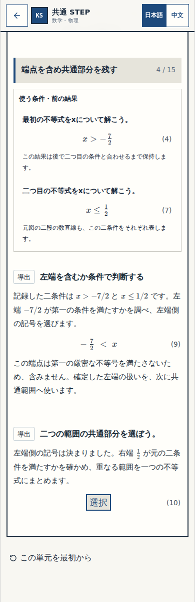
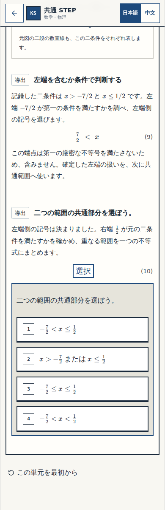
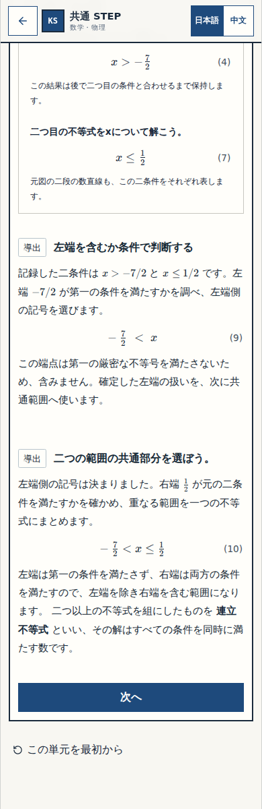
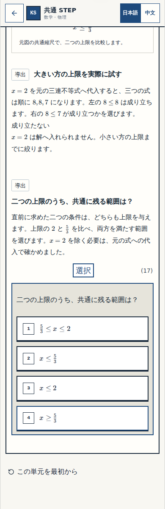
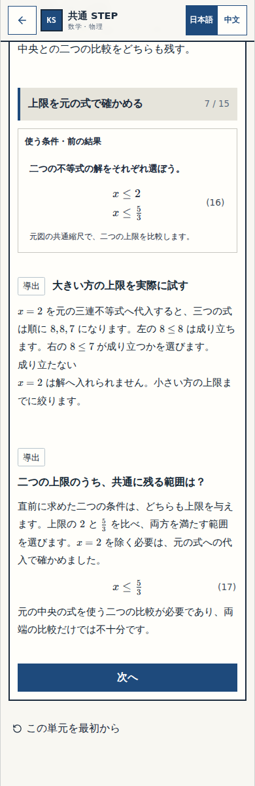
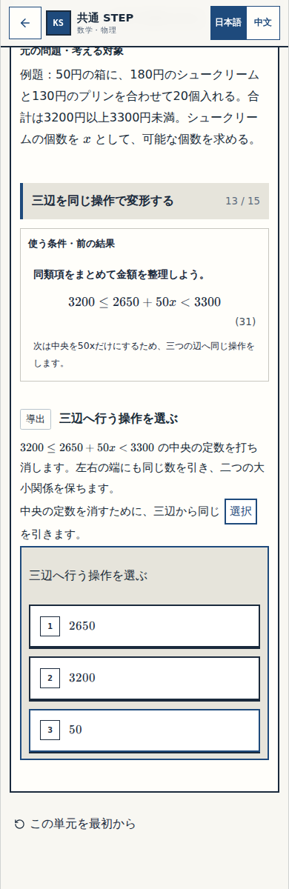
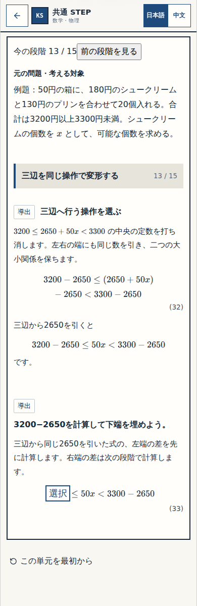

# N12 — P006五箇所の実画像確認①

状態：実画像確認①待ち。N11/N12のR07正式検証・意味審査は完了、未公開。

固定した教材sourceは `f129ba78e496f0ccbce917c762357a81b92b0a2c`。専用CI [41657273611](https://github.com/rrikunagasige-dot/kyotsu-step-web/actions/runs/41657273611)、artifact13240616794、原ZIP SHA256 `abdffd3fad108f5419be263ec150ba60039a7ea896ee0306729763932ead9801` の実画像です。本番には未公開です。

確認するのは、根拠を読みながら自分で判断・計算し、正答後に結論と次の問いへつながる見え方です。P006で承認された五変更だけを適用し、46問の回答・保存契約と他44箇所を保持しています。

今回の本人確認①はN12の五箇所。N11の不変表示へのac2ac082了承は保持し、修正版sourceのCI対応を別途確認しています。この確認を公開許可・最終アプリ受入へ転用しません。

## 本人に見ていただく4点

1. 第一の条件を、途中式から自分で完成できるか。
2. 左端、右端、共通範囲の順に考えられるか（端点の二nodeを一組として確認）。
3. 二つの上限を比べ、自分で共通範囲を判断できるか。
4. 三辺に行う操作を選び、その後の計算へ自然に進めるか。

以下はこの4点に対応する五箇所の未回答／正答後の画像です。

## 第一の条件を自分で完成する

未回答：

正答後：

## 左端を含むか判断する

未回答：

正答後：

## 右端を確かめ、共通範囲を作る

未回答：

正答後：

## 二つの上限から共通範囲を選ぶ

未回答：

正答後：

## 三辺から引く数を選び、次の計算へ進む

未回答：

正答後：

四幅（320/390/430/1440）の各未回答・誤答・正答画像と段階全景は同じCI raw/n12-focusに保存しています。長大な段階/履歴全景だけでは可読性を判断せず、この通常viewport画像を中心に確認してください。

検証：両単元の専用CI、全85正答・236誤答候補の四幅検査、保存/再読込/移行、非作者の実画像意味審査を完了。これは今回の確認①に渡す根拠で、公開可否は後のG3で別途確認します。

## この後の工程

本人確認①で指摘がなければ、現sourceの横断G2（native順はN11→N12）へ進みます。その後N11/N12をそろえた公開前資料を用意し、公開に関する実承認と実URLの検証を経て、合意した全範囲の本人アプリ確認を一回行います。追加指摘があれば修正工程へ戻ります。

## 配布照合の経緯

source087842acの初回CIはN12本体のstage漏れでBASELINEでした。原証拠を保持して新版の証明から除外し、sourcef129へ全8candidate pathのcommit/worktree/native hash一致とremote blob照合を行いました。上記の画像は修正後の実CIだけです。
