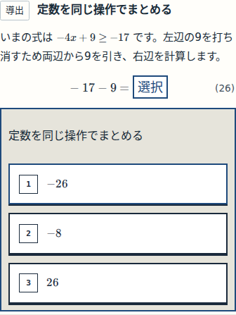
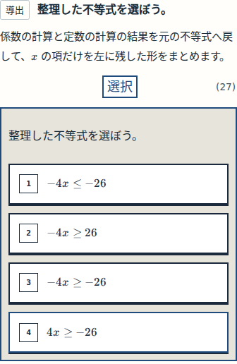

# N11 実装・確認用画像

承認P-W047-06の6箇所を実装。39回答、41保持node、旧保存revision11、W038表示・採点・式番号は保持。子agentは内容担当と表示担当の2人だけを稼働。

## 自分で計算し、元の不等式へ戻る

先に定数部分を計算する。全体の不等式をこの空で先に完成させない。

次に、認定した係数・定数を使って元の不等式全体を組み立てる。

## 検証と現在地

- 固定local source：f04e3d214ce1fd26fd7342a548f7fcd75b29bc0b。GitHubの保存版は同一製品bytesを収録し、記録ファイルを追加している。
- 各320/390/430/1440pxで39正答・109誤答候補、14段階・原図2点、履歴/再読込/resize、旧revision1〜10移行がPASS。
- build、変形33件、現在版の既存behavior4件がPASS。非作者の内容・実画像評価もPASS。
- 旧Workのファイル固定テストと自動CI2本のFAILは保存。検査を弱めて全体PASSにはしていない。教材作成基盤のCIは成功。
- 正式R06とR07_VERIFYは完了。次はR07_SEMANTICのCI画像登録・意味審査。普通教材のローカル画像を受け入れる既存経路がないため、実画像の評価と正式登録を区別している。
- 手動CI起動APIは現在未提供、接続元ブラウザも取得できない。接続ブラウザを使用できる状態から、既存review-screenshot-evidenceの実行・現在sourceのcapture登録へ再開する。
- N12の5箇所は承認・生成・契約検査済み。本体はまだ未適用。公開と本人受入は未実施。

[生成された火柴図の現在地](generated/CURRENT_POSITION.md) / [CI原結果と失敗理由](evidence/CI_FINAL_STATUS.json) / [四幅の原結果](evidence/browser-n11/REPORT.json)
