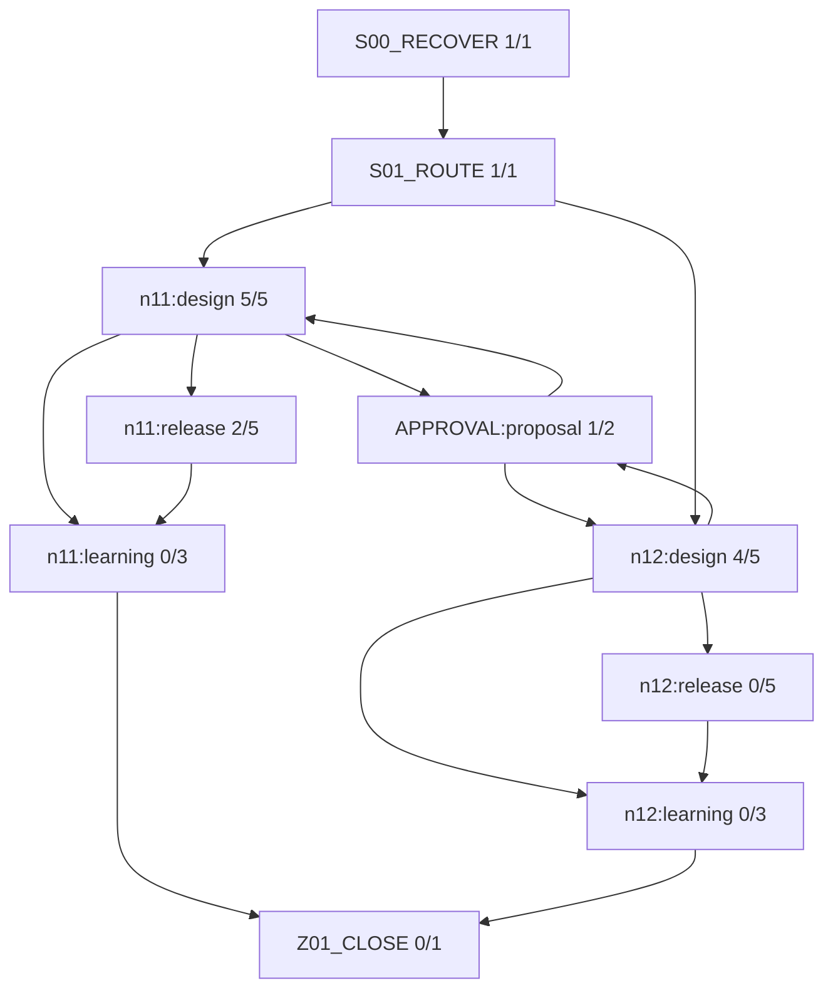

# 全体火柴図（GENERATED）

台帳HEAD: `a75bcff8f2c9c980b0907efca38fce549f52d47b276d59b24e185772718b0d81`

現在: G2_AUDIT@n11 / READY
保留・修正queue: 9
関連修正Work: W-TECH-048, W-TECH-049
差戻しは再分析・失効・子Workの台帳イベントで記録し、実行依存へ循環を入れない。

## 主担当と2 subagent（同じsnapshot）

| node | 担当 | 役割 | 対象 | 状態 |
|---|---|---|---|---|
| R04_PROPOSAL@n11 | A / /root/w047_review_a | reviewer | design: teaching | COMPLETED |
| R04_PROPOSAL@n11 | B / /root/w047_review_b | reviewer | render: layout | COMPLETED |
| R04_PROPOSAL@n11 | A / /root/w047_review_design | reviewer | design: teaching | COMPLETED |
| R04_PROPOSAL@n11 | B / /root/w047_review_layout | reviewer | render: layout | COMPLETED |
| R04_PROPOSAL@n11 | A / /root/w047_review_design | reviewer | design: teaching | COMPLETED |
| R04_PROPOSAL@n11 | B / /root/w047_review_layout | reviewer | render: layout | COMPLETED |
| R04_PROPOSAL@n11 | A / /root/w047_review_design | reviewer | design: teaching | COMPLETED |
| R04_PROPOSAL@n11 | B / /root/w047_review_layout | reviewer | render: layout | COMPLETED |
| R04_PROPOSAL@n12 | A / /root/w047_review_design | reviewer | design: teaching | COMPLETED |
| R04_PROPOSAL@n12 | B / /root/w047_review_layout | reviewer | render: layout | COMPLETED |
| R04_PROPOSAL@n11 | A / /root/w047_review_design | reviewer | design: teaching | COMPLETED |
| R04_PROPOSAL@n11 | B / /root/w047_review_layout | reviewer | render: layout | COMPLETED |
| R04_PROPOSAL@n11 | B / /root/w047_review_layout | reviewer | design: teaching | COMPLETED |
| R04_PROPOSAL@n11 | A / /root/w047_review_design | reviewer | render: layout | COMPLETED |
| R04_PROPOSAL@n11 | A / /root/w047_layout_sourcefirst | reviewer | render: layout | COMPLETED |
| R04_PROPOSAL@n11 | B / /root/w047_review_layout | reviewer | design: teaching | COMPLETED |
| R04_PROPOSAL@n11 | A / /root/w047_layout_sourcefirst | reviewer | render: layout | COMPLETED |
| R04_PROPOSAL@n12 | A / /root/w047_review_design | reviewer | design: teaching | COMPLETED |
| R04_PROPOSAL@n12 | B / /root/w047_layout_sourcefirst | reviewer | render: layout | COMPLETED |
| R04_PROPOSAL@n11 | B / /root/w047_review_layout | reviewer | design: teaching | COMPLETED |
| R04_PROPOSAL@n11 | A / /root/w047_layout_sourcefirst | reviewer | render: layout | COMPLETED |
| R04_PROPOSAL@n12 | A / /root/w047_review_design | reviewer | design: teaching | COMPLETED |
| R04_PROPOSAL@n12 | B / /root/w047_layout_sourcefirst | reviewer | render: layout | COMPLETED |
| R04_PROPOSAL@n11 | B / /root/w047_review_layout | reviewer | design: teaching | COMPLETED |
| R04_PROPOSAL@n11 | A / /root/w047_layout_sourcefirst | reviewer | render: layout | COMPLETED |
| R04_PROPOSAL@n12 | A / /root/w047_review_design | reviewer | design: teaching | COMPLETED |
| R04_PROPOSAL@n12 | B / /root/w047_layout_sourcefirst | reviewer | render: layout | COMPLETED |
| R07_SEMANTIC@n11 | A / /root/w047_review_design | reviewer | render: implemented-visible | COMPLETED |
| R07_SEMANTIC@n11 | A / /root/w047_review_design | reviewer | render: implemented-visible | COMPLETED |

CODE: 担当・packet・対象hash・非作者・未解決を検査。AI: 原資料・数学・教え方・実表示を審査。USER: 具体案承認と実アプリ評価。
役割交代は作者履歴を消さない。差戻しは元工程への改訂taskとして記録。

finding記録: 30
- D04 / n11 / teaching / OPEN / KEEPに残る判断の先出し。直前の代入計算は左右の数値を得る行為だが、その後の意味判断は成立・不成立まで本文で確定している。学習者が根拠を評価して境界を判断する部分が、説明済みの結論と選択肢を対応させる行為へ縮小する。変更3nodeの改善だけではN11全体の学習行為保存を肯定できない。
- D04 / n11 / teaching / VERIFIED_FIXED / 成立・不成立の断定を削除した。先行する代入nodeの回答後説明も5<5または5≤5という関係の提示までで、その評価を断定しない。数値計算から関係の評価、境界包含と理由の選択へ進む行為が復帰した。既に求めた範囲を根拠として参照できることは、原文の順序にも整合する。
- D04 / n11 / teaching / VERIFIED_FIXED / word-p-000495/000501の関係評価と境界包含判断が維持される。直前の代入nodeの回答後説明も関係の提示までで、成立・不成立は断定しない。前回修正の解決を維持。
- D04 / n11 / teaching / VERIFIED_FIXED / 5<5と5≤5の関係を提示しても成立・不成立は先出ししない。原文q07/q10の評価と境界判断が維持される。
- D04 / n11 / teaching / VERIFIED_FIXED / 原文p495は元式への代入関係を根拠に境界を含むか答える課題、p501も含有と理由の判断課題。候補は既習計算で得た5<5/5≤5を提示するが、baselineの「成り立ちません」「成り立ちます」を除去。学習者が関係の真偽と境界含有を対応させる操作を残す。解決後に理由付き結論を示し、F02はn11-10解決後なので未回答判断を図で先出ししない。
- D04 / n11 / teaching / VERIFIED_FIXED / 原文p495は元式への代入関係を根拠に境界を含むか答える課題、p501も含有と理由の判断課題。候補は既習計算で得た5<5/5≤5を提示するが、baselineの「成り立ちません」「成り立ちます」を除去。学習者が関係の真偽と境界含有を対応させる操作を残す。解決後に理由付き結論を示し、F02はn11-10解決後なので未回答判断を図で先出ししない。
- D04 / n11 / teaching / VERIFIED_FIXED / 原文p495は元式への代入関係を根拠に境界を含むか答える課題、p501も含有と理由の判断課題。候補は既習計算で得た5<5/5≤5を提示するが、baselineの「成り立ちません」「成り立ちます」を除去。学習者が関係の真偽と境界含有を対応させる操作を残す。解決後に理由付き結論を示し、F02はn11-10解決後なので未回答判断を図で先出ししない。
- D04 / n11 / teaching / VERIFIED_FIXED / 原文p495は元式への代入関係を根拠に境界を含むか答える課題、p501も含有と理由の判断課題。候補は既習計算で得た5<5/5≤5を提示するが、baselineの「成り立ちません」「成り立ちます」を除去。学習者が関係の真偽と境界含有を対応させる操作を残す。解決後に理由付き結論を示し、F02はn11-10解決後なので未回答判断を図で先出ししない。
- D05 / n11 / teaching / OPEN / 操作を選択させる前段で、操作と数3を指定している。後続の左辺・右辺の空欄は同じ3の再現になる。正数倍の根拠を教える説明自体は正しいが、原文q13にある『操作を選ぶ』行為を保存したKEEPと評価するには不足がある。
- D05 / n11 / teaching / VERIFIED_FIXED / 両辺3倍という具体操作の先出しを除去。乗算という足場の下で、分母を打ち消す乗数を3/-3/1/6から判断する行為が残る。右辺にも3を掛けるnodeは左辺で3を選んだ後なので、既知の結果を使う段階であり未選択答案の先出しには当たらない。
- D05 / n11 / teaching / VERIFIED_FIXED / 具体的な両辺3倍を先出しせず、乗数を選ぶ空欄が残る。word-p-000511の具体操作選択と直後の不等式の構成が維持される。前回に自身で読んだ候補では冒頭が「例題は」だったが、現候補は「次の不等式」となり、原文の確認問題との役割の不一致も弱まった。
- D05 / n11 / teaching / VERIFIED_FIXED / 具体的な両辺3倍の先出しを除去した状態を維持。分母を打ち消す乗数を選ぶ行為が残る。
- D05 / n11 / teaching / VERIFIED_FIXED / 原文p511は分母をなくす操作を選び直後の不等式を書く課題。候補問題導入は「両辺に同じ数を掛ける」まで教え、baselineの「両辺を3倍」を削除。左nodeで分母を打ち消す乗数3を選び、解決後その同じ3を右辺の和全体へ適用する。右nodeの左辺結果は既解決情報であり先代行ではない。原文p509「確認」に対する呼称も「次の不等式」で整合。
- D05 / n11 / teaching / VERIFIED_FIXED / 原文p511は分母をなくす操作を選び直後の不等式を書く課題。候補問題導入は「両辺に同じ数を掛ける」まで教え、baselineの「両辺を3倍」を削除。左nodeで分母を打ち消す乗数3を選び、解決後その同じ3を右辺の和全体へ適用する。右nodeの左辺結果は既解決情報であり先代行ではない。原文p509「確認」に対する呼称も「次の不等式」で整合。
- D05 / n11 / teaching / VERIFIED_FIXED / 原文p511は分母をなくす操作を選び直後の不等式を書く課題。候補問題導入は「両辺に同じ数を掛ける」まで教え、baselineの「両辺を3倍」を削除。左nodeで分母を打ち消す乗数3を選び、解決後その同じ3を右辺の和全体へ適用する。右nodeの左辺結果は既解決情報であり先代行ではない。原文p509「確認」に対する呼称も「次の不等式」で整合。
- D05 / n11 / teaching / VERIFIED_FIXED / 原文p511は分母をなくす操作を選び直後の不等式を書く課題。候補問題導入は「両辺に同じ数を掛ける」まで教え、baselineの「両辺を3倍」を削除。左nodeで分母を打ち消す乗数3を選び、解決後その同じ3を右辺の和全体へ適用する。右nodeの左辺結果は既解決情報であり先代行ではない。原文p509「確認」に対する呼称も「次の不等式」で整合。
- N11-R2-L07 / n11 / layout / OPEN / 原資料word-p-000509の「確認」および現role=checkに対し、新本文が「例題は」と呼ぶため、教材区分の呼称整合が未解決。配置の静的評価は良好のまま。
- N11-R2-L07 / n11 / layout / VERIFIED_FIXED / IR・compiled・現在nodeのvisible snapshotのすべてで旧「例題は」が「次の不等式」へ変わった。原文p509「確認」、role=check、goal「分数の確認問題を提示」と矛盾する呼称を除去した。
- N11-R2-L07 / n11 / layout / VERIFIED_FIXED / IR・compiled・現在nodeのvisible snapshotのすべてで旧「例題は」が「次の不等式」へ変わった。原文p509「確認」、role=check、goal「分数の確認問題を提示」と矛盾する呼称を除去した。
- N11-R2-L07 / n11 / layout / VERIFIED_FIXED / candidate compiled本文は「例題」を含まず「次の不等式」となっている。現authoredのrole=checkはreaderのroles対応で「学んだことを使う」となり、元の確認問題を例題と混同する本文ラベルは静的に解消。候補実画像での最終確認は未実施。
- N11-R2-L07 / n11 / layout / VERIFIED_FIXED / 原問word-p-000509は「確認」、word-p-000510は分数不等式を解く設問。候補n11-fraction-problemはrole=check、goal=「分数の確認問題を提示」を維持し、beforeは「次の不等式…です。分母をなくす操作を考えます」と接続する。既存readerはcheckを「学んだことを使う」と表示するため、例題・導出・定義への誤分類はない。候補本文もこの確認問題を例題とは呼ばず、未解決の呼称・設問区分の不一致は認めない。分母を打ち消す数は次の設問に残される。
- N11-R2-L07 / n11 / layout / VERIFIED_FIXED / 原問word-p-000509は「確認」、word-p-000510は分数不等式を解く設問。候補n11-fraction-problemはrole=check、goal=「分数の確認問題を提示」を維持し、beforeは「次の不等式…です。分母をなくす操作を考えます」と接続する。既存readerはcheckを「学んだことを使う」と表示するため、例題・導出・定義への誤分類はない。候補本文もこの確認問題を例題とは呼ばず、未解決の呼称・設問区分の不一致は認めない。分母を打ち消す数は次の設問に残される。
- N11-R2-L07 / n11 / layout / VERIFIED_FIXED / 原問word-p-000509は「確認」、word-p-000510は分数不等式を解く設問。候補n11-fraction-problemはrole=check、goal=「分数の確認問題を提示」を維持し、beforeは「次の不等式…です。分母をなくす操作を考えます」と接続する。既存readerはcheckを「学んだことを使う」と表示するため、例題・導出・定義への誤分類はない。候補本文もこの確認問題を例題とは呼ばず、未解決の呼称・設問区分の不一致は認めない。分母を打ち消す数は次の設問に残される。
- N11-R2-L07 / n11 / layout / VERIFIED_FIXED / 原問word-p-000509は「確認」、word-p-000510は分数不等式を解く設問。候補n11-fraction-problemはrole=check、goal=「分数の確認問題を提示」を維持し、beforeは「次の不等式…です。分母をなくす操作を考えます」と接続する。既存readerはcheckを「学んだことを使う」と表示するため、例題・導出・定義への誤分類はない。候補本文もこの確認問題を例題とは呼ばず、未解決の呼称・設問区分の不一致は認めない。分母を打ち消す数は次の設問に残される。
- N12-D04 / n12 / teaching / OPEN / KEEPに今回の端点判断の結果を先出しする箇所が残る。左端を含むか判断するというnodeのgoalに対し、本文が不充足を確定してから<と≤を選ばせる。続くnodeも右端が両条件を満たすことまで確定する。原問の共通部分・端点判断のうち端点の評価を学習者が行う段階が説明に置き換わる。既知条件の再掲や一般的な端点記号の説明とは異なり、この問題の端点についての判断結果である。SPECの「既知知識から導ける判断は考えさせる」と整合しない。
- N12-D04 / n12 / teaching / VERIFIED_FIXED / 回答前の左端不充足・右端充足の断定を除去し、左端の条件評価、確定結果の利用、右端の二条件評価、共通範囲の式化を学習者に戻している。左端の理由は左端nodeのafterへ、両端の理由は範囲回答後のafterへ移っており、compiledにも同じ順序で残る。先行q03のafterは一般的な共通部分の方針までで、この二端点の答えを先出ししない。
- N12-D04 / n12 / teaching / VERIFIED_FIXED / 回答前の左端不充足・右端充足の断定を除去し、左端の条件評価、確定結果の利用、右端の二条件評価、共通範囲の式化を学習者に戻している。左端の理由は左端nodeのafterへ、両端の理由は範囲回答後のafterへ移っており、compiledにも同じ順序で残る。先行q03のafterは一般的な共通部分の方針までで、この二端点の答えを先出ししない。
- N12-D04 / n12 / teaching / VERIFIED_FIXED / 回答前の左端不充足・右端充足の断定を除去し、左端の条件評価、確定結果の利用、右端の二条件評価、共通範囲の式化を学習者に戻している。左端の理由は左端nodeのafterへ、両端の理由は範囲回答後のafterへ移っており、compiledにも同じ順序で残る。先行q03のafterは一般的な共通部分の方針までで、この二端点の答えを先出ししない。
- CI-V06 / n11 / implemented-visible / OPEN / 段階全体の実PNGには中央位置で固定ヘッダ/本文へ移動ボタンが展開説明の上に重なり、当該本文・式の一部を視認できない。局所focusの合格からこの隠れた全段階文脈まで合格とはできない。通常UIの恒常欠陥かスクリーンショット時のscroll/sticky由来かは未切分け。隠れた箇所を覆わない文脈画像または通常viewportの証拠が必要。
- CI-V06 / n11 / implemented-visible / VERIFIED_FIXED / 前者で3(2x+3)=6x+9、(6-10)x+9≥-17/6-10=-4、-17-9=-26(26)、記録説明、結果を元不等式へ戻す説明と未回答(27)が一つの通常画面に見える。後者で(26)から(27)への接続と4選択肢を同時に確認できる。対象本文・式を画面中央の固定ヘッダが覆う旧長大写真の不足は新viewport証拠で解消した。旧画像そのものを修正済みとは称さず、旧UNVERIFIED報告は履歴として保持する。
