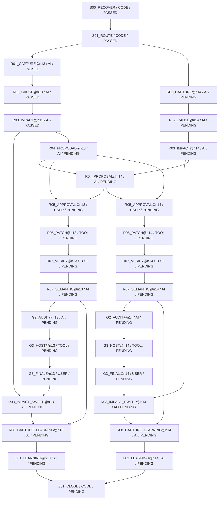

# ブロック火柴図（GENERATED）

台帳HEAD: `e816a11b8ecc2cef3964663e682060c045f4a462394c71ac010c2b5a355d2571`

現在: R04_PROPOSAL@n13 / READY

## 主担当と2 subagent（同じsnapshot）

| node | 担当 | 役割 | 対象 | 状態 |
|---|---|---|---|---|
| — | M / A / B | 未割当 | 必須scopeは各nodeのteam_requirementsを参照 | 未実行 |

CODE: 担当・packet・対象hash・非作者・未解決を検査。AI: 原資料・数学・教え方・実表示を審査。USER: 具体案承認と実アプリ評価。
役割交代は作者履歴を消さない。差戻しは元工程への改訂taskとして記録。

finding記録: 0
