# 機能火柴図（GENERATED）

台帳HEAD: `360c69354d29682958b428952c9a781c8044ff51fa9f72fd64b19a5e6887740d`

# R01_CAPTURE@n13（GENERATED）

台帳HEAD: `360c69354d29682958b428952c9a781c8044ff51fa9f72fd64b19a5e6887740d`

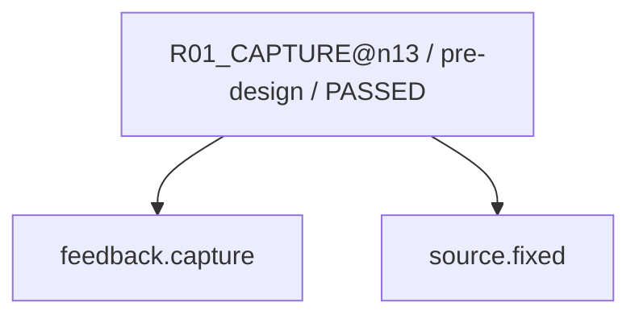

現在: R02_CAUSE@n13 / READY

# R02_CAUSE@n13（GENERATED）

台帳HEAD: `360c69354d29682958b428952c9a781c8044ff51fa9f72fd64b19a5e6887740d`


現在: R02_CAUSE@n13 / READY

# R03_IMPACT@n13（GENERATED）

台帳HEAD: `360c69354d29682958b428952c9a781c8044ff51fa9f72fd64b19a5e6887740d`

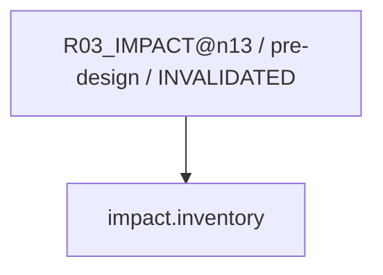

現在: R02_CAUSE@n13 / READY

# R04_PROPOSAL@n13（GENERATED）

台帳HEAD: `360c69354d29682958b428952c9a781c8044ff51fa9f72fd64b19a5e6887740d`


現在: R02_CAUSE@n13 / READY

# R04_PROPOSAL@n13（GENERATED）

台帳HEAD: `360c69354d29682958b428952c9a781c8044ff51fa9f72fd64b19a5e6887740d`

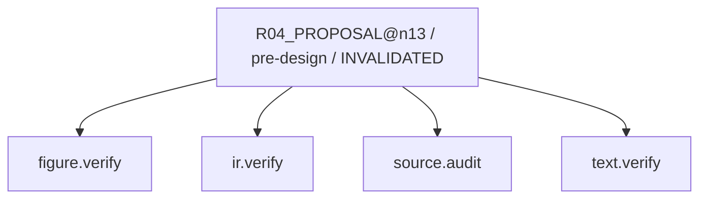

現在: R02_CAUSE@n13 / READY

# R04_PROPOSAL@n13（GENERATED）

台帳HEAD: `360c69354d29682958b428952c9a781c8044ff51fa9f72fd64b19a5e6887740d`

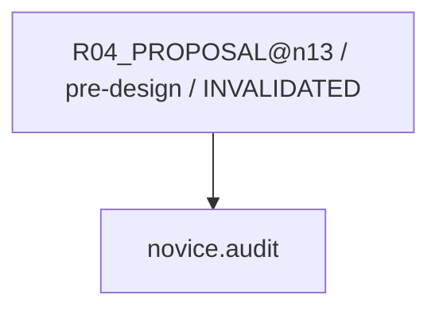

現在: R02_CAUSE@n13 / READY

# R06_PATCH@n13（GENERATED）

台帳HEAD: `360c69354d29682958b428952c9a781c8044ff51fa9f72fd64b19a5e6887740d`

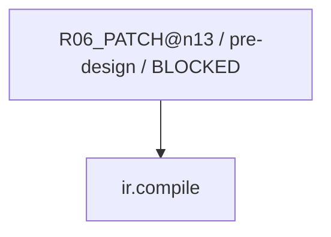

現在: R02_CAUSE@n13 / READY

# R07_VERIFY@n13（GENERATED）

台帳HEAD: `360c69354d29682958b428952c9a781c8044ff51fa9f72fd64b19a5e6887740d`

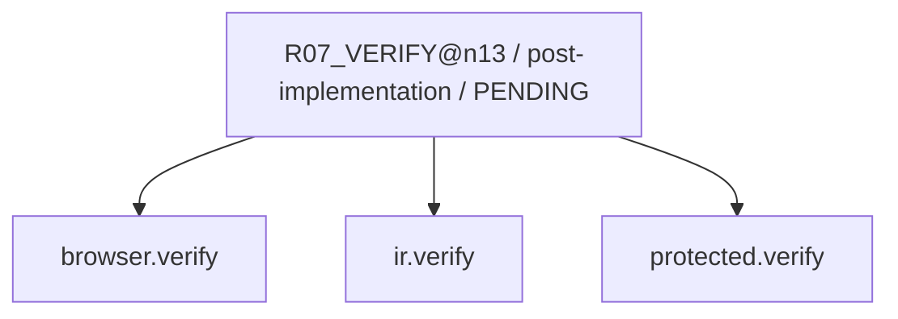

現在: R02_CAUSE@n13 / READY

# R07_SEMANTIC@n13（GENERATED）

台帳HEAD: `360c69354d29682958b428952c9a781c8044ff51fa9f72fd64b19a5e6887740d`

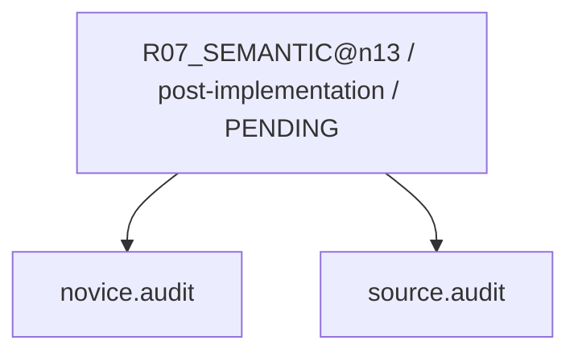

現在: R02_CAUSE@n13 / READY

# R01_CAPTURE@n14（GENERATED）

台帳HEAD: `360c69354d29682958b428952c9a781c8044ff51fa9f72fd64b19a5e6887740d`

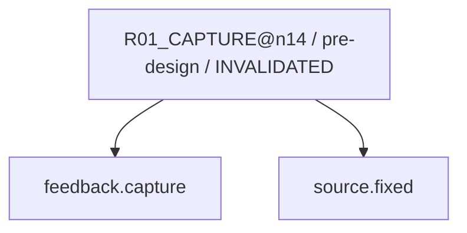

現在: R02_CAUSE@n13 / READY

# R02_CAUSE@n14（GENERATED）

台帳HEAD: `360c69354d29682958b428952c9a781c8044ff51fa9f72fd64b19a5e6887740d`

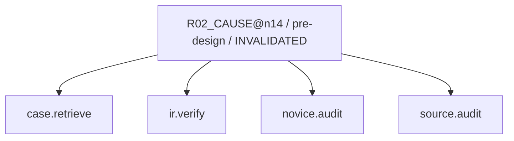

現在: R02_CAUSE@n13 / READY

# R03_IMPACT@n14（GENERATED）

台帳HEAD: `360c69354d29682958b428952c9a781c8044ff51fa9f72fd64b19a5e6887740d`

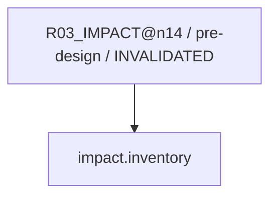

現在: R02_CAUSE@n13 / READY

# R04_PROPOSAL@n14（GENERATED）

台帳HEAD: `360c69354d29682958b428952c9a781c8044ff51fa9f72fd64b19a5e6887740d`

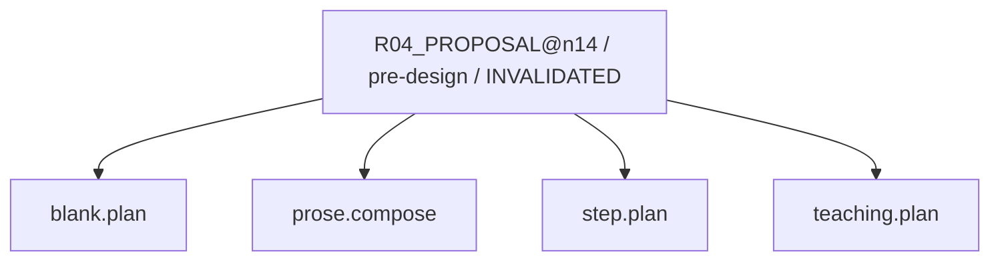

現在: R02_CAUSE@n13 / READY

# R04_PROPOSAL@n14（GENERATED）

台帳HEAD: `360c69354d29682958b428952c9a781c8044ff51fa9f72fd64b19a5e6887740d`


現在: R02_CAUSE@n13 / READY

# R04_PROPOSAL@n14（GENERATED）

台帳HEAD: `360c69354d29682958b428952c9a781c8044ff51fa9f72fd64b19a5e6887740d`

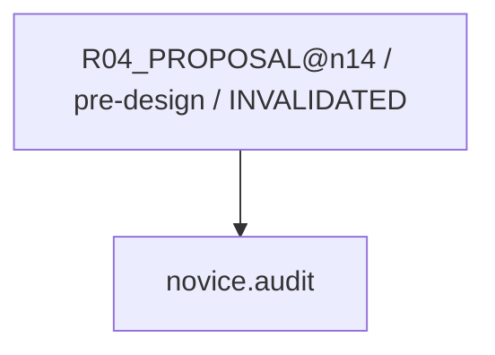

現在: R02_CAUSE@n13 / READY

# R06_PATCH@n14（GENERATED）

台帳HEAD: `360c69354d29682958b428952c9a781c8044ff51fa9f72fd64b19a5e6887740d`


現在: R02_CAUSE@n13 / READY

# R07_VERIFY@n14（GENERATED）

台帳HEAD: `360c69354d29682958b428952c9a781c8044ff51fa9f72fd64b19a5e6887740d`


現在: R02_CAUSE@n13 / READY

# R07_SEMANTIC@n14（GENERATED）

台帳HEAD: `360c69354d29682958b428952c9a781c8044ff51fa9f72fd64b19a5e6887740d`


現在: R02_CAUSE@n13 / READY

# G2_AUDIT@n13（GENERATED）

台帳HEAD: `360c69354d29682958b428952c9a781c8044ff51fa9f72fd64b19a5e6887740d`

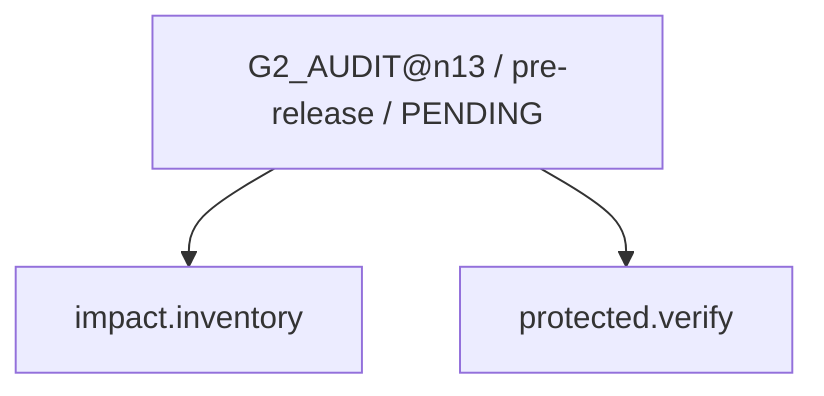

現在: R02_CAUSE@n13 / READY

# G3_HOST@n13（GENERATED）

台帳HEAD: `360c69354d29682958b428952c9a781c8044ff51fa9f72fd64b19a5e6887740d`

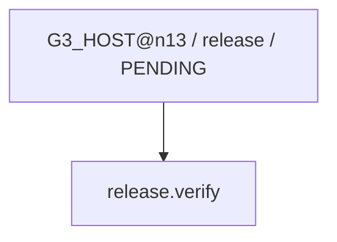

現在: R02_CAUSE@n13 / READY

# R03_IMPACT_SWEEP@n13（GENERATED）

台帳HEAD: `360c69354d29682958b428952c9a781c8044ff51fa9f72fd64b19a5e6887740d`

```mermaid
flowchart TD
  N0["R03_IMPACT_SWEEP@n13 / post-fix / PENDING"]
  N1["impact.inventory"]
  N0 --> N1
```

現在: R02_CAUSE@n13 / READY

# R08_CAPTURE_LEARNING@n13（GENERATED）

台帳HEAD: `360c69354d29682958b428952c9a781c8044ff51fa9f72fd64b19a5e6887740d`

```mermaid
flowchart TD
  N0["R08_CAPTURE_LEARNING@n13 / repair-finalization / PENDING"]
  N1["case.finalize"]
  N0 --> N1
```

現在: R02_CAUSE@n13 / READY

# L01_LEARNING@n13（GENERATED）

台帳HEAD: `360c69354d29682958b428952c9a781c8044ff51fa9f72fd64b19a5e6887740d`

```mermaid
flowchart TD
  N0["L01_LEARNING@n13 / learning / PENDING"]
  N1["case.finalize"]
  N2["ml.train"]
  N0 --> N1
  N0 --> N2
```

現在: R02_CAUSE@n13 / READY

# G2_AUDIT@n14（GENERATED）

台帳HEAD: `360c69354d29682958b428952c9a781c8044ff51fa9f72fd64b19a5e6887740d`

```mermaid
flowchart TD
  N0["G2_AUDIT@n14 / pre-release / PENDING"]
  N1["protected.verify"]
  N2["impact.inventory"]
  N0 --> N2
  N0 --> N1
```

現在: R02_CAUSE@n13 / READY

# G3_HOST@n14（GENERATED）

台帳HEAD: `360c69354d29682958b428952c9a781c8044ff51fa9f72fd64b19a5e6887740d`

```mermaid
flowchart TD
  N0["G3_HOST@n14 / release / PENDING"]
  N1["release.verify"]
  N0 --> N1
```

現在: R02_CAUSE@n13 / READY

# R03_IMPACT_SWEEP@n14（GENERATED）

台帳HEAD: `360c69354d29682958b428952c9a781c8044ff51fa9f72fd64b19a5e6887740d`

```mermaid
flowchart TD
  N0["R03_IMPACT_SWEEP@n14 / post-fix / PENDING"]
  N1["impact.inventory"]
  N0 --> N1
```

現在: R02_CAUSE@n13 / READY

# R08_CAPTURE_LEARNING@n14（GENERATED）

台帳HEAD: `360c69354d29682958b428952c9a781c8044ff51fa9f72fd64b19a5e6887740d`

```mermaid
flowchart TD
  N0["R08_CAPTURE_LEARNING@n14 / repair-finalization / PENDING"]
  N1["case.finalize"]
  N0 --> N1
```

現在: R02_CAUSE@n13 / READY

# L01_LEARNING@n14（GENERATED）

台帳HEAD: `360c69354d29682958b428952c9a781c8044ff51fa9f72fd64b19a5e6887740d`

```mermaid
flowchart TD
  N0["L01_LEARNING@n14 / learning / PENDING"]
  N1["case.finalize"]
  N2["ml.train"]
  N0 --> N1
  N0 --> N2
```

現在: R02_CAUSE@n13 / READY

code実行receiptはsnapshot.jsonのcapability_receiptsを参照。AIの意味審査は別記録。

## 主担当と2 subagent（同じsnapshot）

| node | 担当 | 役割 | 対象 | 状態 |
|---|---|---|---|---|
| R04_PROPOSAL@n13 | A / /root/w048_review_a | reviewer | design: teaching | COMPLETED |
| R04_PROPOSAL@n13 | B / /root/w048_review_b | reviewer | render: layout | COMPLETED |
| R04_PROPOSAL@n13 | A / /root/w048_review_a | reviewer | design: teaching | COMPLETED |
| R04_PROPOSAL@n13 | B / /root/w048_review_b | reviewer | render: layout | COMPLETED |
| R04_PROPOSAL@n13 | A / /root/w048_review_a | reviewer | design: teaching | COMPLETED |
| R04_PROPOSAL@n13 | B / /root/w048_review_b | reviewer | render: layout | COMPLETED |
| R04_PROPOSAL@n14 | A / /root/w048_review_a | reviewer | design: teaching | COMPLETED |
| R04_PROPOSAL@n14 | B / /root/w048_review_b | reviewer | render: layout | COMPLETED |

CODE: 担当・packet・対象hash・非作者・未解決を検査。AI: 原資料・数学・教え方・実表示を審査。USER: 具体案承認と実アプリ評価。
役割交代は作者履歴を消さない。差戻しは元工程への改訂taskとして記録。

finding記録: 4
- W048-P001-N13-R04-B-LEFT-ALIGN-001 / n13 / layout / OPEN / 同一導出の左端揃えが実式本文へ届かない。proposed Page w048ScopedStyleの .reading-formula-line{text-align:left} に対し、実consumer TextbookFormulaContentは .reading-formula-expression のflex内へ式partsを出す。global.css:974-980のjustify-content:centerが存続し、N13はtypesetting非対象のため中央配置が続く。Q05の350px以下はglobal.css:1457-1481でgrid中央配置も残る。revision限定で実本文flex/gridの配置を明示的に上書きし、新targetとして再審査が必要。
- W048-P001-N13-R04-B-LEFT-ALIGN-001 / n13 / layout / OPEN / P002は通常flexの中央寄せを修正するが、N13 Q05の350px以下grid中央寄せを上書きできない。新selectorは3 classで詳細度(0,3,0)、旧global.css:1463-1474 selectorは2 class+2 attributeで(0,4,0)。旧justify-content:center/justify-items:centerが勝つため、320pxで左右2条件rowの左端揃え契約を満たさない。実式本文と狭幅特例に届くrevision限定selectorを凍結して再審査が必要。
- W048-P001-N13-R04-B-LEFT-ALIGN-001 / n13 / layout / VERIFIED_FIXED / P003の実consumer祖先に一致するrevision限定selectorは詳細度(0,5,0)。通常flex(0,1,0)およびN13 Q05狭幅grid(0,4,0)より優先し、justify-content:flex-startとjustify-items:startの両指定が届く。B独立のcssselect2/tinycss2照合でN13の13導出formula行×320/350/351/390/430/1440px=78条件を検査し、全条件で両propertyの勝者を確認。rootの32条件静的CODE証拠のPage SHAと内容も照合。実DOM/実座標検証は含まない。
- W048-P001-N13-R04-B-LEFT-ALIGN-001 / n13 / layout / VERIFIED_FIXED / P003の実consumer祖先に一致するrevision限定selectorは詳細度(0,5,0)。通常flex(0,1,0)およびN13 Q05狭幅grid(0,4,0)より優先し、justify-content:flex-startとjustify-items:startの両指定が届く。B独立のcssselect2/tinycss2照合でN13の13導出formula行×320/350/351/390/430/1440px=78条件を検査し、全条件で両propertyの勝者を確認。rootの32条件静的CODE証拠のPage SHAと内容も照合。実DOM/実座標検証は含まない。

### R04_PROPOSAL@n13 の担当別審査
- teaching / design / source-review / 非作者=True
- layout / render / learner-visible-review / 非作者=True
### R07_SEMANTIC@n13 の担当別審査
- implemented-visible / render / learner-visible-review / 非作者=True
### R04_PROPOSAL@n14 の担当別審査
- teaching / design / source-review / 非作者=True
- layout / render / learner-visible-review / 非作者=True
### R07_SEMANTIC@n14 の担当別審査
- implemented-visible / render / learner-visible-review / 非作者=True
### G2_AUDIT@n13 の担当別審査
- integrated-release / render / learner-visible-review / 非作者=True
### G2_AUDIT@n14 の担当別審査
- integrated-release / render / learner-visible-review / 非作者=True
