# 機能火柴図（GENERATED）

台帳HEAD: `e816a11b8ecc2cef3964663e682060c045f4a462394c71ac010c2b5a355d2571`

# R01_CAPTURE@n13（GENERATED）

台帳HEAD: `e816a11b8ecc2cef3964663e682060c045f4a462394c71ac010c2b5a355d2571`

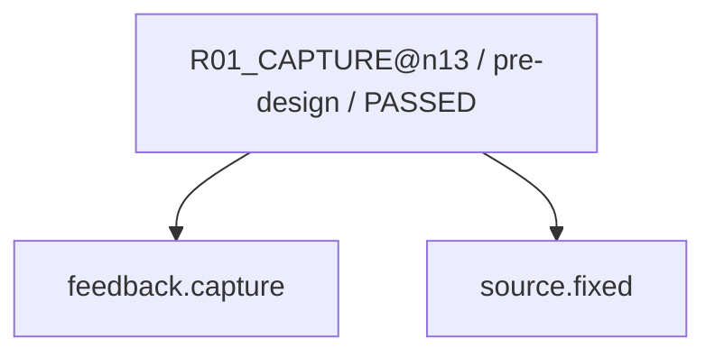

現在: R04_PROPOSAL@n13 / READY

# R02_CAUSE@n13（GENERATED）

台帳HEAD: `e816a11b8ecc2cef3964663e682060c045f4a462394c71ac010c2b5a355d2571`

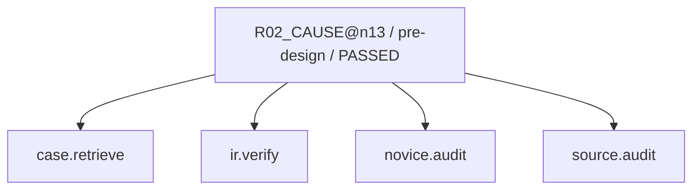

現在: R04_PROPOSAL@n13 / READY

# R03_IMPACT@n13（GENERATED）

台帳HEAD: `e816a11b8ecc2cef3964663e682060c045f4a462394c71ac010c2b5a355d2571`

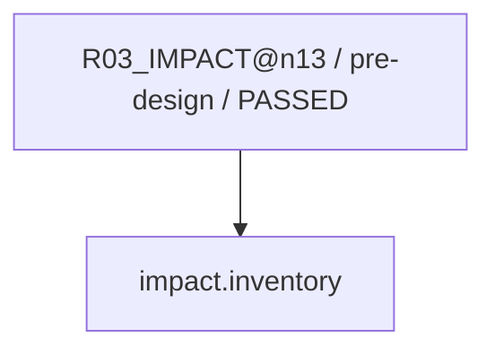

現在: R04_PROPOSAL@n13 / READY

# R04_PROPOSAL@n13（GENERATED）

台帳HEAD: `e816a11b8ecc2cef3964663e682060c045f4a462394c71ac010c2b5a355d2571`

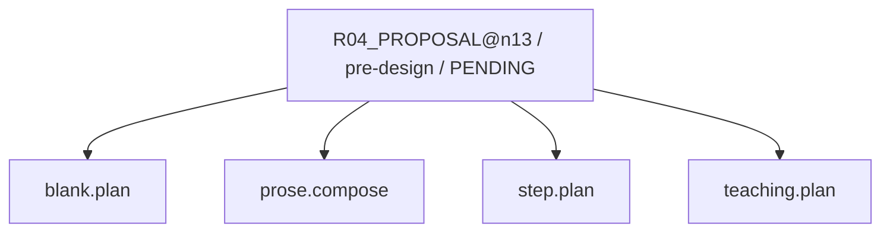

現在: R04_PROPOSAL@n13 / READY

# R04_PROPOSAL@n13（GENERATED）

台帳HEAD: `e816a11b8ecc2cef3964663e682060c045f4a462394c71ac010c2b5a355d2571`

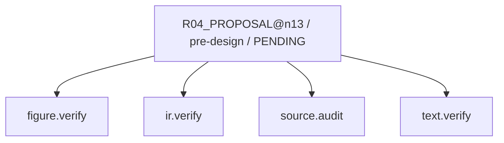

現在: R04_PROPOSAL@n13 / READY

# R04_PROPOSAL@n13（GENERATED）

台帳HEAD: `e816a11b8ecc2cef3964663e682060c045f4a462394c71ac010c2b5a355d2571`


現在: R04_PROPOSAL@n13 / READY

# R06_PATCH@n13（GENERATED）

台帳HEAD: `e816a11b8ecc2cef3964663e682060c045f4a462394c71ac010c2b5a355d2571`

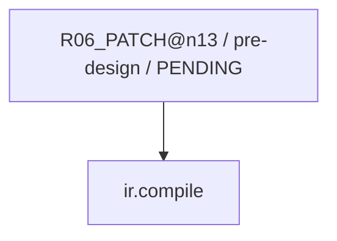

現在: R04_PROPOSAL@n13 / READY

# R07_VERIFY@n13（GENERATED）

台帳HEAD: `e816a11b8ecc2cef3964663e682060c045f4a462394c71ac010c2b5a355d2571`

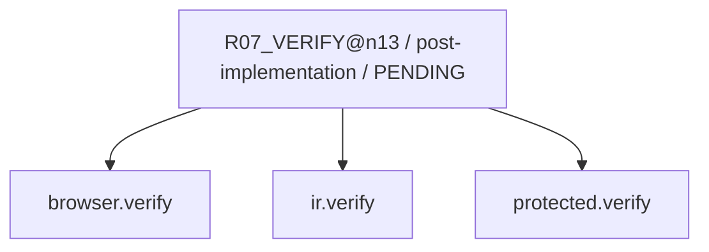

現在: R04_PROPOSAL@n13 / READY

# R07_SEMANTIC@n13（GENERATED）

台帳HEAD: `e816a11b8ecc2cef3964663e682060c045f4a462394c71ac010c2b5a355d2571`

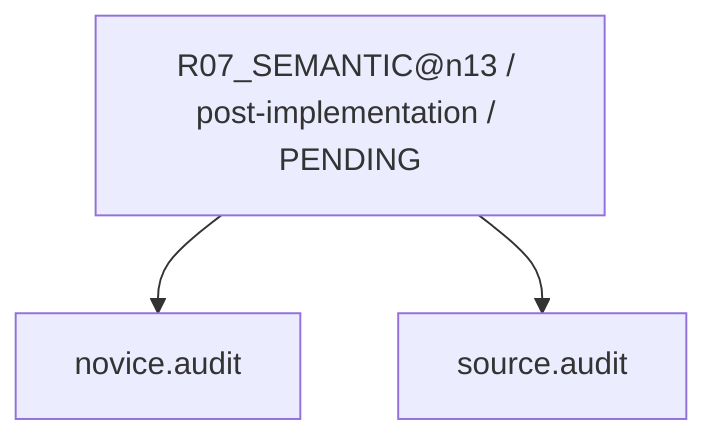

現在: R04_PROPOSAL@n13 / READY

# R01_CAPTURE@n14（GENERATED）

台帳HEAD: `e816a11b8ecc2cef3964663e682060c045f4a462394c71ac010c2b5a355d2571`

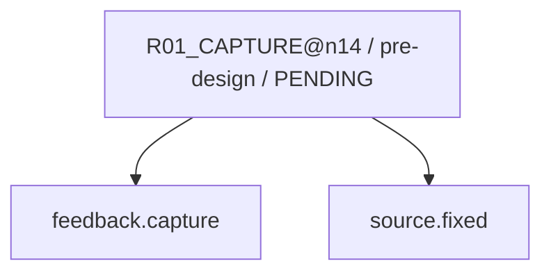

現在: R04_PROPOSAL@n13 / READY

# R02_CAUSE@n14（GENERATED）

台帳HEAD: `e816a11b8ecc2cef3964663e682060c045f4a462394c71ac010c2b5a355d2571`


現在: R04_PROPOSAL@n13 / READY

# R03_IMPACT@n14（GENERATED）

台帳HEAD: `e816a11b8ecc2cef3964663e682060c045f4a462394c71ac010c2b5a355d2571`

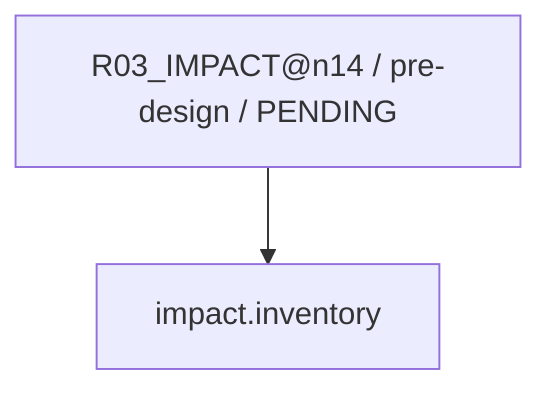

現在: R04_PROPOSAL@n13 / READY

# R04_PROPOSAL@n14（GENERATED）

台帳HEAD: `e816a11b8ecc2cef3964663e682060c045f4a462394c71ac010c2b5a355d2571`

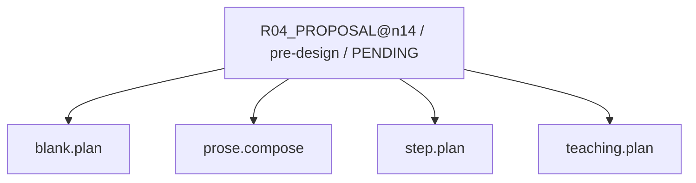

現在: R04_PROPOSAL@n13 / READY

# R04_PROPOSAL@n14（GENERATED）

台帳HEAD: `e816a11b8ecc2cef3964663e682060c045f4a462394c71ac010c2b5a355d2571`


現在: R04_PROPOSAL@n13 / READY

# R04_PROPOSAL@n14（GENERATED）

台帳HEAD: `e816a11b8ecc2cef3964663e682060c045f4a462394c71ac010c2b5a355d2571`

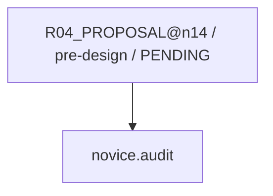

現在: R04_PROPOSAL@n13 / READY

# R06_PATCH@n14（GENERATED）

台帳HEAD: `e816a11b8ecc2cef3964663e682060c045f4a462394c71ac010c2b5a355d2571`


現在: R04_PROPOSAL@n13 / READY

# R07_VERIFY@n14（GENERATED）

台帳HEAD: `e816a11b8ecc2cef3964663e682060c045f4a462394c71ac010c2b5a355d2571`


現在: R04_PROPOSAL@n13 / READY

# R07_SEMANTIC@n14（GENERATED）

台帳HEAD: `e816a11b8ecc2cef3964663e682060c045f4a462394c71ac010c2b5a355d2571`


現在: R04_PROPOSAL@n13 / READY

# G2_AUDIT@n13（GENERATED）

台帳HEAD: `e816a11b8ecc2cef3964663e682060c045f4a462394c71ac010c2b5a355d2571`

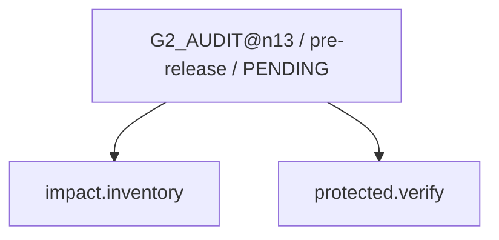

現在: R04_PROPOSAL@n13 / READY

# G3_HOST@n13（GENERATED）

台帳HEAD: `e816a11b8ecc2cef3964663e682060c045f4a462394c71ac010c2b5a355d2571`

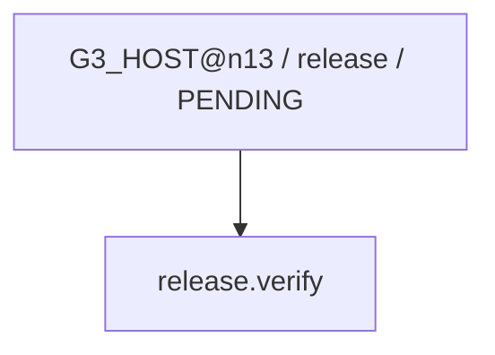

現在: R04_PROPOSAL@n13 / READY

# R03_IMPACT_SWEEP@n13（GENERATED）

台帳HEAD: `e816a11b8ecc2cef3964663e682060c045f4a462394c71ac010c2b5a355d2571`

```mermaid
flowchart TD
  N0["R03_IMPACT_SWEEP@n13 / post-fix / PENDING"]
  N1["impact.inventory"]
  N0 --> N1
```

現在: R04_PROPOSAL@n13 / READY

# R08_CAPTURE_LEARNING@n13（GENERATED）

台帳HEAD: `e816a11b8ecc2cef3964663e682060c045f4a462394c71ac010c2b5a355d2571`

```mermaid
flowchart TD
  N0["R08_CAPTURE_LEARNING@n13 / repair-finalization / PENDING"]
  N1["case.finalize"]
  N0 --> N1
```

現在: R04_PROPOSAL@n13 / READY

# L01_LEARNING@n13（GENERATED）

台帳HEAD: `e816a11b8ecc2cef3964663e682060c045f4a462394c71ac010c2b5a355d2571`

```mermaid
flowchart TD
  N0["L01_LEARNING@n13 / learning / PENDING"]
  N1["case.finalize"]
  N2["ml.train"]
  N0 --> N1
  N0 --> N2
```

現在: R04_PROPOSAL@n13 / READY

# G2_AUDIT@n14（GENERATED）

台帳HEAD: `e816a11b8ecc2cef3964663e682060c045f4a462394c71ac010c2b5a355d2571`

```mermaid
flowchart TD
  N0["G2_AUDIT@n14 / pre-release / PENDING"]
  N1["protected.verify"]
  N2["impact.inventory"]
  N0 --> N2
  N0 --> N1
```

現在: R04_PROPOSAL@n13 / READY

# G3_HOST@n14（GENERATED）

台帳HEAD: `e816a11b8ecc2cef3964663e682060c045f4a462394c71ac010c2b5a355d2571`

```mermaid
flowchart TD
  N0["G3_HOST@n14 / release / PENDING"]
  N1["release.verify"]
  N0 --> N1
```

現在: R04_PROPOSAL@n13 / READY

# R03_IMPACT_SWEEP@n14（GENERATED）

台帳HEAD: `e816a11b8ecc2cef3964663e682060c045f4a462394c71ac010c2b5a355d2571`

```mermaid
flowchart TD
  N0["R03_IMPACT_SWEEP@n14 / post-fix / PENDING"]
  N1["impact.inventory"]
  N0 --> N1
```

現在: R04_PROPOSAL@n13 / READY

# R08_CAPTURE_LEARNING@n14（GENERATED）

台帳HEAD: `e816a11b8ecc2cef3964663e682060c045f4a462394c71ac010c2b5a355d2571`

```mermaid
flowchart TD
  N0["R08_CAPTURE_LEARNING@n14 / repair-finalization / PENDING"]
  N1["case.finalize"]
  N0 --> N1
```

現在: R04_PROPOSAL@n13 / READY

# L01_LEARNING@n14（GENERATED）

台帳HEAD: `e816a11b8ecc2cef3964663e682060c045f4a462394c71ac010c2b5a355d2571`

```mermaid
flowchart TD
  N0["L01_LEARNING@n14 / learning / PENDING"]
  N1["case.finalize"]
  N2["ml.train"]
  N0 --> N1
  N0 --> N2
```

現在: R04_PROPOSAL@n13 / READY

code実行receiptはsnapshot.jsonのcapability_receiptsを参照。AIの意味審査は別記録。

## 主担当と2 subagent（同じsnapshot）

| node | 担当 | 役割 | 対象 | 状態 |
|---|---|---|---|---|
| — | M / A / B | 未割当 | 必須scopeは各nodeのteam_requirementsを参照 | 未実行 |

CODE: 担当・packet・対象hash・非作者・未解決を検査。AI: 原資料・数学・教え方・実表示を審査。USER: 具体案承認と実アプリ評価。
役割交代は作者履歴を消さない。差戻しは元工程への改訂taskとして記録。

finding記録: 0

### R04_PROPOSAL@n13 の担当別審査
- teaching / design / source-review / 非作者=True
- layout / render / learner-visible-review / 非作者=True
### R07_SEMANTIC@n13 の担当別審査
- implemented-visible / render / learner-visible-review / 非作者=True
### R04_PROPOSAL@n14 の担当別審査
- teaching / design / source-review / 非作者=True
- layout / render / learner-visible-review / 非作者=True
### R07_SEMANTIC@n14 の担当別審査
- implemented-visible / render / learner-visible-review / 非作者=True
### G2_AUDIT@n13 の担当別審査
- integrated-release / render / learner-visible-review / 非作者=True
### G2_AUDIT@n14 の担当別審査
- integrated-release / render / learner-visible-review / 非作者=True
